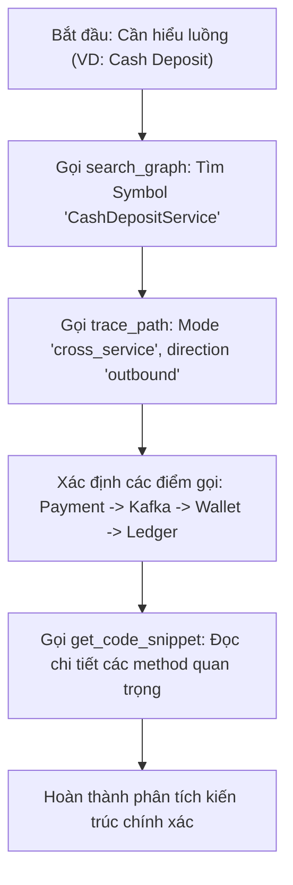

# Tài Liệu Chuẩn: codebase-memory-mcp (Codebase Knowledge Graph Engine)

---

## 1. Giới Thiệu & Mục Đích

`codebase-memory-mcp` là hệ thống MCP Server chuyên trách xây dựng và truy vấn đồ thị tri thức mã nguồn (AST Knowledge Graph) cho toàn bộ hệ thống **E-Wallet Monolith & Microservices**.

Thay vì sử dụng các phương thức tìm kiếm văn bản thô sơ (`grep`, `find`, `cat`) tốn context window và dễ đứt gãy luồng logic, `codebase-memory-mcp` phân tích cú pháp tĩnh (AST) thành mạng lưới thực thể đồ thị:
- **Nodes:** Classes, Interfaces, Records, Methods, Functions, API Routes, Enums, DTOs, Kafka Topics, Configs.
- **Edges:** `CALLS`, `INHERITS`, `IMPLEMENTS`, `CALL_REFERENCE`, `DEPENDS_ON`, `DATA_FLOW`, `CROSS_SERVICE`.

### Thông Tin Cấu Hình Hệ Thống
- **Đường dẫn thực thi:** `/home/buidi/.local/bin/codebase-memory-mcp`
- **Phiên bản:** `0.12.1`
- **Cấu hình Agent:** `.agents/mcp_config.json`
- **Chế độ Web UI:** Hỗ trợ trực quan hóa đồ thị tại cổng mặc định `:9749` (`codebase-memory-mcp config set --ui=true`).

---

## 2. Nguyên Tắc Cốt Lõi Cho AI Agents (Agent Rules)

> [!IMPORTANT]
> **Quy Tắc Vàng (Graph-First Principle):**
> 1. **Ưu tiên đồ thị trước văn bản:** Khi tìm hiểu luồng nghiệp vụ hoặc tìm định nghĩa, bắt buộc dùng `search_graph` hoặc `trace_path` trước khi dùng `search_code` hoặc `grep`.
> 2. **Trích xuất mục tiêu với `get_code_snippet`:** Chỉ lấy đúng phạm vi code của symbol cần đọc thay vì đọc toàn bộ file hàng nghìn dòng.
> 3. **Phân tích tác động (Impact Analysis):** Trước khi sửa đổi hoặc tái cấu trúc một hàm/lớp (đặc biệt trong `common-library` hoặc các Service Core), luôn dùng `trace_path` với `direction: inbound` để rà soát toàn bộ các nơi phụ thuộc.
> 4. **Bảo toàn tính toàn vẹn (Graph Freshness):** Khi có thay đổi kiến trúc hoặc thêm mới microservice, kiểm tra `detect_changes` hoặc re-index để đảm bảo đồ thị luôn phản ánh hiện trạng mới nhất.

---

## 3. Danh Mục Chi Tiết 17 Công Cụ (Toolsets Reference)

Hệ thống cung cấp 17 công cụ chia thành 6 nhóm nghiệp vụ:

### Nhóm 1: Khám Phá Kiến Trúc (Architecture & Discovery)

#### `get_architecture`
- **Mục đích:** Trích xuất góc nhìn kiến trúc tổng thể của repository (layers, modules, entry points, boundaries, routes).
- **Tham số chính:**
  - `project` (bắt buộc): Tên project đã index (ví dụ: `app-mono-di-va-khoa`).
  - `aspects`: Mảng tiêu chí phân tích: `["overview", "structure", "dependencies", "routes", "layers", "boundaries", "hotspots", "cycles"]`.
  - `path`: Lọc theo thư mục tiền tố (ví dụ: `services/payment-service`).
  - `format`: `"tree"` hoặc `"json"`.

#### `get_file_outline`
- **Mục đích:** Xem nhanh dàn ý cấu trúc của một file (danh sách class, interface, method, import) mà không cần nạp toàn bộ nội dung file.
- **Tham số chính:**
  - `project`: Tên project.
  - `file_path`: Đường dẫn file tương đối trong workspace (ví dụ: `services/wallet-service/src/main/java/.../WalletService.java`).

#### `get_graph_schema`
- **Mục đích:** Xem schema các kiểu node (Node Types) và các quan hệ (Edge Types) được engine hỗ trợ trong đồ thị.
- **Tham số chính:** `project`.

#### `list_projects`
- **Mục đích:** Liệt kê tất cả các dự án / workspaces hiện có trong bộ nhớ đồ thị tri thức cùng trạng thái index.

---

### Nhóm 2: Tìm Kiếm & Truy Vấn Đồ Thị (Search & Query)

#### `search_graph`
- **Mục đích:** Tìm kiếm symbols theo từ khóa BM25, regex name, qualified name pattern, hoặc semantic query.
- **Tham số chính:**
  - `project` (bắt buộc).
  - `query`: Từ khóa tìm kiếm (symbol name).
  - `name_pattern` / `qn_pattern`: Regex lọc tên hoặc qualified name.
  - `file_pattern`: Regex lọc theo đường dẫn file (ví dụ: `.*payment.*`).
  - `detail`: `"ids"` hoặc `"default"`.
  - `include_connected`: Bật `true` để lấy kèm các node liên kết trực tiếp (caller, callee, implements).
  - `limit`: Số lượng kết quả (1 - 500, mặc định: 50).

#### `query_graph`
- **Mục đích:** Truy vấn đồ thị nâng cao dạng multi-hop traversal (quan hệ nhiều tầng cha-con, quan hệ cấu trúc phức tạp).
- **Tham số chính:**
  - `project` (bắt buộc).
  - `start_node_id` / `start_qn`: Điểm khởi đầu truy vấn.
  - `edge_types`: Lọc loại liên kết (ví dụ: `["CALLS", "IMPLEMENTS"]`).
  - `depth`: Độ sâu duyệt đồ thị (1 - 10).

#### `search_code`
- **Mục đích:** Tìm kiếm literal/regex dự phòng khi đồ thị có khoảng trống coverage hoặc cần tìm chuỗi cấu hình cụ thể trong file properties/yaml/sql.
- **Tham số chính:**
  - `project` (bắt buộc).
  - `pattern`: Chuỗi regex cần tìm.
  - `file_pattern`: Giới hạn loại file.

---

### Nhóm 3: Lần Dấu Vết Luồng & Quan Hệ (Tracing & Call Graphs)

#### `trace_path`
- **Mục đích:** Phân tích luồng gọi hàm, chuỗi phụ thuộc, luồng dữ liệu (Data Flow), hoặc đường đi xuyên dịch vụ (Cross-Service).
- **Tham số chính:**
  - `project` (bắt buộc).
  - `function_name` (bắt buộc): Tên hàm hoặc qualified name cần trace.
  - `direction`: `"inbound"` (ai gọi hàm này?), `"outbound"` (hàm này gọi những ai?), `"both"` (cả hai hướng).
  - `mode`:
    - `"calls"`: Chuỗi gọi hàm tiêu chuẩn.
    - `"data_flow"`: Lần theo tham số biến dữ liệu truyền qua các tầng.
    - `"cross_service"`: Lần luồng gọi API / Message giữa các microservices.
    - `"topology"`: Rà soát hạ tầng, routes, controllers.
    - `"deploy"` / `"run"`: Khám phá script build, Dockerfile và runtime setup.
  - `depth`: Độ sâu phân tích (1 - 15, mặc định: 3).
  - `include_tests`: `false` (mặc định loại bỏ test để tập trung vào logic sản phẩm).

#### `compare_graphs`
- **Mục đích:** So sánh sự sai khác cấu trúc đồ thị giữa 2 snapshots, branches hoặc trạng thái commit.
- **Tham số chính:** `project_a`, `project_b`.

---

### Nhóm 4: Đọc Mã Nguồn Trọng Tâm (Code Extraction)

#### `get_code_snippet`
- **Mục đích:** Trích xuất nguyên bản mã nguồn của một symbol cụ thể (hàm, lớp, enum) dựa trên đồ thị AST.
- **Tham số chính:**
  - `project` (bắt buộc).
  - `qn`: Qualified name của symbol (ví dụ: `com.fintech.gateway.JwtAuthenticationFilter.filter`).
  - `file`: Đường dẫn file chứa symbol.

---

### Nhóm 5: Quản Lý Chỉ Mục & Sức Khỏe Đồ Thị (Index Lifecycle)

#### `index_repository`
- **Mục đích:** Khởi chạy hoặc cập nhật tiến trình lập chỉ mục toàn bộ repository.
- **Tham số chính:**
  - `repo_path`: Đường dẫn thư mục gốc workspace.
  - `project`: Tên định danh project trong memory.
  - `incremental`: `true` để lập chỉ mục gia tăng (chỉ quét file thay đổi).

#### `index_status`
- **Mục đích:** Kiểm tra trạng thái index hiện tại (tiến độ, số lượng node, số lượng edge, thời gian index lần cuối).

#### `check_index_coverage`
- **Mục đích:** Kiểm tra tỷ lệ bao phủ của index đối với các module trong dự án, phát hiện các thư mục hoặc loại file bị bỏ qua.

#### `detect_changes`
- **Mục đích:** So sánh trạng thái file trên đĩa cứng với index đã lưu để chỉ ra danh sách file mới, file bị sửa đổi hoặc xóa bỏ.

#### `delete_project`
- **Mục đích:** Dọn dẹp và giải phóng tài nguyên cache của một project không còn sử dụng.

---

### Nhóm 6: Ra Quyết Định Kiến Trúc & Vết Chạy (ADR & Tracing)

#### `manage_adr`
- **Mục đích:** Quản lý tài liệu Quyết định Kiến trúc (Architectural Decision Records) gắn kết trực tiếp với các node trong đồ thị mã nguồn.
- **Thao tác:** `create`, `list`, `link`, `status`.

#### `ingest_traces`
- **Mục đích:** Nạp dữ liệu OpenTelemetry / Distributed Traces thời gian chạy để làm giàu đồ thị tĩnh, đối chiếu luồng lý thuyết và lưu lượng thực tế.

---

## 4. Quy Trình Phối Hợp Mẫu Dành Cho Agents (Workflows)

### Quy Trình 1: Khám Phá Luồng Nghiệp Vụ Mới


### Quy Trình 2: Đánh Giá Tác Động Trước Khi Tái Cấu Trúc (Refactoring)
1. **Xác định mục tiêu:** Chạy `search_graph` để lấy Qualified Name của method/class cần chỉnh sửa.
2. **Quét người gọi:** Chạy `trace_path` với `direction: "inbound"` và `depth: 5`.
3. **Lập danh sách ảnh hưởng:** Rà soát tất cả downstream controllers/services chịu tác động.
4. **Thực thi sửa đổi:** Tiến hành chỉnh sửa code và chạy unit test tương ứng.
5. **Cập nhật đồ thị:** Chạy `detect_changes` để kiểm tra độ đồng bộ.

---

## 5. Tham Chiếu Cấu Hình Nhanh

Cấu hình mẫu trong `.agents/mcp_config.json`:
```json
{
  "mcpServers": {
    "codebase-memory": {
      "command": "/home/buidi/.local/bin/codebase-memory-mcp",
      "args": []
    }
  }
}
```

Lệnh kiểm tra trực tiếp từ dòng lệnh CLI:
```bash
# Kiểm tra phiên bản và danh mục tool
codebase-memory-mcp --version

# Liệt kê danh sách dự án đã index
codebase-memory-mcp cli list_projects

# Tìm kiếm nhanh symbol trong dự án
codebase-memory-mcp cli search_graph '{"project":"app-mono-di-va-khoa","query":"JwtAuthenticationFilter"}'
```