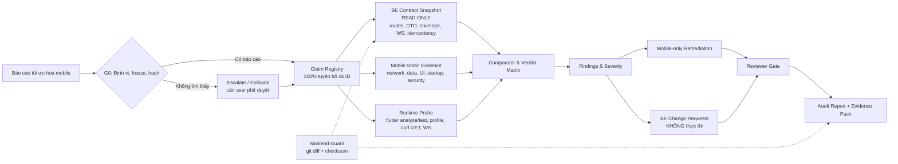
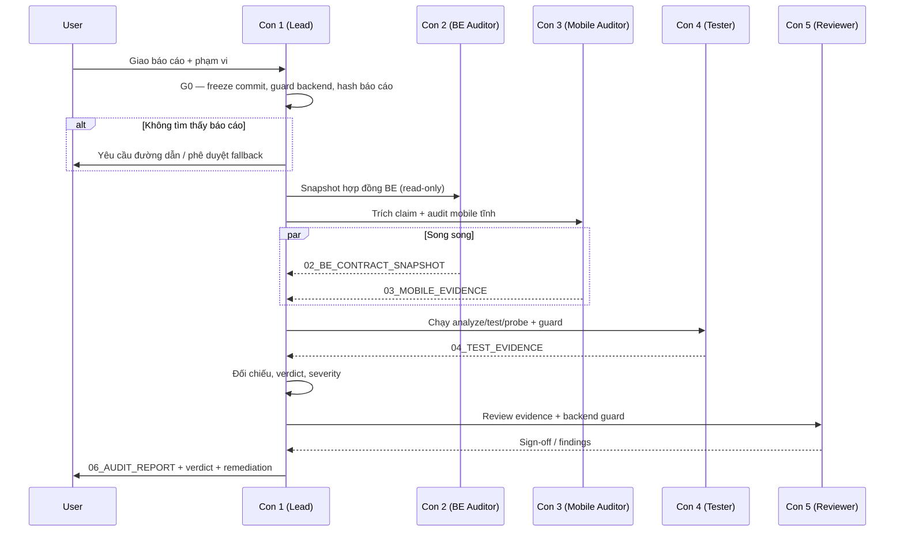

# 01_PLAN — KIỂM CHỨNG BÁO CÁO TỐI ƯU HÓA MOBILE CHUẨN VỚI BACKEND

| Thuộc tính | Giá trị |
|---|---|
| **Mã kế hoạch** | `PLAN-MOB-OPT-AUDIT-001` |
| **Phiên bản** | `1.0` — Draft |
| **Ngày lập** | 2026-10-20 |
| **Người lập** | Con 1 — Lead Agent / System Architect & Planner |
| **Repo** | `core-banking-microservices` |
| **Commit nền** | `75bf273cd707571c13073a625390a78adfa320ce` |
| **Trạng thái** | Chờ Gate G0 (xác nhận vị trí báo cáo) |
| **Ràng buộc bất biến** | **TUYỆT ĐỐI KHÔNG SỬA BACKEND** |
| **Đầu ra cuối** | `06_MOBILE_OPTIMIZATION_AUDIT.md` + evidence + verdict matrix |

---

## 0. TÓM TẮT ĐIỀU HÀNH

**Mục tiêu:** Kiểm chứng báo cáo tối ưu hóa mobile có đúng sự thật, có bằng chứng đo/kiểm được, và có khớp với hợp đồng backend hiện tại hay không — **trong điều kiện không được sửa bất kỳ dòng code backend nào**.

**Kết quả bàn giao:**
1. Báo cáo kiểm chứng `06_MOBILE_OPTIMIZATION_AUDIT.md` với kết luận **ĐẠT / ĐẠT CÓ ĐIỀU KIỆN / KHÔNG ĐẠT**.
2. Bảng đối chiếu từng tuyên bố (claim) với bằng chứng `file:line`, lệnh chạy, số đo thực tế.
3. Danh sách lỗi/sai lệch theo mức độ (Blocker / High / Medium / Low).
4. Kế hoạch khắc phục **chỉ trên mobile**; mọi thay đổi backend (nếu cần) chỉ được ghi thành **đề xuất**, không thực thi.
5. Bằng chứng `backend/` không bị thay đổi (git diff rỗng + checksum khớp).

**Phát hiện quan trọng khi khảo sát ban đầu:**
- **Chưa tìm thấy file báo cáo tối ưu hóa mobile** trong repo tại thời điểm lập kế hoạch. Đã kiểm tra `.agents_workspace/`, `mobile/docs/`, `docs/`, root và các file `.md` gần đây. Vì vậy **Gate G0 là gate chặn**: cần user cung cấp đường dẫn báo cáo, hoặc phê duyệt phương án fallback.
- Backend hiện tại là **6 microservices**, không còn monolith trong repo; nhiều endpoint mà mobile/docs tham chiếu **không tồn tại** trong mã nguồn hiện tại (chi tiết tại mục 14).
- `flutter analyze`: **No issues found** (4.8s).
- `flutter test`: **49 pass / 38 fail** — danh sách fail hiển thị bắt đầu bằng `test/be_integration_test.dart` (cần phân loại đầy đủ ở Phase 4). Đây là baseline, không được dùng để kết luận "báo cáo sai" nếu báo cáo chỉ nói về unit/widget test.
- `git status --porcelain -- backend`: **0 dòng**. Checksum backend nền: `eb37871177838108be4df91e6498e40645f610eaff1ed308e1a587c09b0aa003`.

---

## 1. BỐI CẢNH & VẤN ĐỀ

### 1.1. Bối cảnh hệ thống
- **Mobile:** Flutter, Clean Architecture, 113 file Dart trong `mobile/lib`, 50+ màn hình, UI Liquid Glass (`liquid_glass_widgets`), quản lý trạng thái BLoC/Cubit, Dio + STOMP WebSocket.
- **Backend:** Java 17 / Spring Boot 3.2.5, 6 microservices (`api-gateway`, `identity-service`, `wallet-service`, `payment-service`, `ledger-service`, `notification-service`), PostgreSQL, Redis, RabbitMQ/Kafka.
- **Điểm nối:** API Gateway `http://localhost:8080/api/v1`, WebSocket `/ws-native`, JWT, header tin cậy `X-User-Id` do gateway bơm xuống.

### 1.2. Vì sao phải kiểm chứng báo cáo tối ưu hóa?
1. **Tài liệu và code đã lệch nhau:** `mobile/docs/API_INTEGRATION_GUIDE.md` liệt kê nhiều endpoint như `/wallets/deposit`, `/bills/*`, `/config/limits`… nhưng không có controller tương ứng trong 6 microservices hiện tại. Nếu báo cáo lấy tài liệu làm chuẩn, kết luận sẽ sai.
2. **Tối ưu hóa thường gắn với giả định backend:** số round-trip, kích thước payload, phân trang, timeout, retry, idempotency, WebSocket topic. Chỉ cần một giả định sai là toàn bộ khuyến nghị vô nghĩa.
3. **Rủi ro "tối ưu ảo":** báo cáo có thể nêu FPS, thời gian tải, mức giảm payload… nhưng không có thiết bị, build mode, phương pháp đo, sample size.
4. **Rủi ro vượt rào:** một khuyến nghị "thêm batch API", "nới page size", "thêm cache ở gateway" sẽ yêu cầu sửa backend — vi phạm ràng buộc của nhiệm vụ.
5. **Rủi ro che giấu lỗi:** báo cáo có thể bỏ qua các endpoint không tồn tại, hoặc đánh đồng "feature chưa có" với "hiệu năng kém".

### 1.3. Câu hỏi trung tâm
> Báo cáo tối ưu hóa mobile có đang mô tả đúng thực tế mobile + backend, có bằng chứng tái lập được, và mọi khuyến nghị có thể thực hiện mà **không sửa backend** hay không?

---

## 2. MỤC TIÊU & CÂU HỎI KIỂM CHỨNG

| ID | Câu hỏi | Tiêu chí trả lời |
|---|---|---|
| **Q1** | Báo cáo nào, phiên bản nào, do ai tạo, phạm vi đến đâu? | Có đường dẫn + hash + ngày + phạm vi rõ ràng |
| **Q2** | Báo cáo đưa ra những tuyên bố nào? | 100% tuyên bố được trích xuất thành claim có ID |
| **Q3** | Tuyên bố nào phụ thuộc backend? | Mỗi claim có cờ `be_dependency` và endpoint/DTO liên quan |
| **Q4** | Endpoint, method, request, response, phân trang, auth, lỗi, idempotency, WebSocket có khớp backend? | Đối chiếu `file:line` backend + mobile; 0 mâu thuẫn chưa xử lý |
| **Q5** | Các con số hiệu năng có tái lập được không? | Có thiết bị, build mode, tool, sample, p50/p95; hoặc đánh dấu UNVERIFIABLE |
| **Q6** | Khuyến nghị nào yêu cầu sửa backend? | Tách riêng thành "BE change request", không thực thi |
| **Q7** | Nếu báo cáo sai, cần sửa gì trên mobile và nghiệm thu thế nào? | Remediation mobile-only + test + tiêu chí re-audit |

---

## 3. PHẠM VI & RÀNG BUỘC

### 3.1. Trong phạm vi
- Kiểm chứng nội dung báo cáo tối ưu hóa mobile (hiệu năng UI/GPU, mạng, cache, phân trang, khởi động, bộ nhớ, kích thước app, bảo mật/độ tin cậy liên quan hiệu năng).
- Đối chiếu với **mã nguồn backend tại commit nền** (read-only) và **mã nguồn mobile hiện tại**.
- Chạy các kiểm tra tĩnh/động **an toàn**: `flutter analyze`, `flutter test`, build size, profile mode, `curl GET`, WebSocket subscribe.
- Lập verdict matrix, findings, remediation plan mobile-only, và báo cáo cuối.

### 3.2. Ngoài phạm vi
- Triển khai tối ưu hóa thực tế trên mobile (chỉ làm ở Phase 7 nếu user phê duyệt).
- Bổ sung feature còn thiếu (QR, bills, beneficiaries, PIN/OTP backend…).
- Sửa backend, gateway, DB schema, migration, docker-compose của backend.
- eKYC/AML/PEP, load test phá hoại, thay đổi kiến trúc Hexagonal/Clean Architecture.
- Đánh giá thẩm mỹ UI hoặc nội dung nghiệp vụ ngoài khía cạnh hiệu năng.

### 3.3. Ràng buộc cứng — BACKEND READ-ONLY
> **Không được sửa bất kỳ file nào dưới `backend/`.** Bao gồm code Java, `pom.xml`, `application.yml`, migration SQL, test, tài liệu trong `backend/`.

Quy tắc thực thi:
1. **Cấm** `edit`/`write` vào `backend/**`, `docker-compose.yml` (phần định nghĩa backend), `deploy/**` liên quan backend.
2. **Cấm** chạy migration, DDL, DML, `DROP`, `DELETE`, `UPDATE` trên DB.
3. **Cấm** thay đổi API contract, header, route, response format.
4. Chỉ dùng lệnh đọc: `git`, `rg`, `sed`, `curl GET`, `docker compose ps`, `mvn test` (nếu cần, chỉ đọc source).
5. Trước và sau **mỗi task** phải chạy backend guard:
   ```bash
   git status --porcelain -- backend
   git diff --name-only -- backend
   git ls-tree -r HEAD backend | awk '{print $3"  "$4}' | sort -k2 | sha256sum
   ```
   Kỳ vọng: 0 dòng thay đổi; checksum khớp baseline.
6. Nếu phát hiện backend đã bị thay đổi: **dừng ngay**, báo Lead, không tự ý revert.

### 3.4. Giả định
| ID | Giả định | Nếu sai |
|---|---|---|
| **A1** | Báo cáo là file Markdown/PDF/DOCX do user hoặc agent khác tạo; đường dẫn chưa được cung cấp | Gate G0 chặn; yêu cầu user cung cấp |
| **A2** | Môi trường local có Flutter 3.50 beta, Java 17, Docker; có thể chạy stack backend | Nếu thiếu, đánh dấu UNVERIFIABLE phần runtime; không bịa số |
| **A3** | Backend code tại commit nền là nguồn chuẩn cao nhất | Nếu có monolith legacy đang chạy, phải kiểm tra runtime và ghi rõ |
| **A4** | Tài khoản test lấy từ `ACCOUNTS.md`; không dùng production | Không chạy API mutation nếu không có môi trường cô lập |
| **A5** | Báo cáo có thể chứa cả tuyên bố định tính và định lượng | Tuyên bố định tính vẫn phải có evidence E1+ |

---

## 4. ĐỊNH NGHĨA "CHUẨN VỚI BACKEND" & NGUỒN CHUẨN

### 4.1. Sáu tiêu chí "chuẩn với BE"
Một báo cáo/tuyên bố chỉ được coi là **chuẩn với backend** khi thỏa **tất cả** tiêu chí liên quan:

| # | Tiêu chí | Ví dụ kiểm tra |
|---|---|---|
| **C1** | Endpoint tồn tại đúng method + path | `POST /api/v1/payments/transfer` có trong `TransferController` |
| **C2** | Request khớp schema | `sourceUserId`, `targetUserId`, `amount: Long`, `idempotencyKey` bắt buộc |
| **C3** | Response envelope + field khớp | `success`, `message`, `data`; `data.transactionId`… |
| **C4** | Phân trang/giới hạn khớp | `/transactions` nhận `page`, `size`; `size` bị cap 100 |
| **C5** | Auth/header/role khớp | JWT qua gateway; `X-User-Id` do gateway bơm; WS có `Authorization` |
| **C6** | Idempotency/retry/WS khớp semantics | P2P dùng `idempotencyKey` trong body; WS topic `/topic/wallets/{id}/notifications` |

### 4.2. Thứ tự nguồn chuẩn (Source of Truth)
| Cấp | Nguồn | Dùng khi nào |
|---|---|---|
| **S0** | Hành vi runtime thực tế (stack đang chạy) | Kiểm chứng cuối cùng; phải ghi môi trường/commit |
| **S1** | Mã nguồn backend tại commit nền | Nguồn chuẩn chính cho contract |
| **S2** | OpenAPI/Swagger runtime (nếu có) | Chỉ khi thực sự truy cập được; không suy đoán |
| **S3** | Mã nguồn + test mobile | Bằng chứng phía client |
| **S4** | Tài liệu backend/mobile (`mobile/docs/*.md`) | Tham khảo, **không dùng làm bằng chứng duy nhất** |
| **S5** | Nội dung báo cáo tối ưu hóa | Đối tượng cần kiểm chứng, không phải nguồn chuẩn |

> **Quy tắc vàng:** Khi S4 mâu thuẫn S1, **S1 thắng**. Khi S0 mâu thuẫn S1, ghi nhận là "drift" và điều tra môi trường, không tự sửa backend.

### 4.3. Thuật ngữ
- **Claim:** một tuyên bố/khuyến nghị độc lập trong báo cáo, có ID duy nhất.
- **Evidence:** bằng chứng cụ thể (file:line, lệnh + output, số đo) chứng minh/ bác bỏ claim.
- **Verdict:** PASS / PARTIAL / FAIL / UNVERIFIABLE / OUT_OF_SCOPE.
- **Contract drift:** mobile/docs giả định một hành vi backend không còn đúng.
- **Mobile-only remediation:** thay đổi chỉ trong `mobile/` (code, test, docs mobile).
- **BE change request:** đề xuất thay đổi backend, **không thực thi** trong nhiệm vụ này.

---

## 5. KIẾN TRÚC KIỂM CHỨNG

### 5.1. Sơ đồ tổng thể


### 5.2. Luồng tuần tự


### 5.3. Thành phần & trách nhiệm
| Thành phần | Input | Output | Chế độ lỗi |
|---|---|---|---|
| **Intake & Freeze** | Báo cáo, repo | `00_BASELINE.md`, hash báo cáo | Không tìm thấy báo cáo → chặn G0 |
| **Claim Registry** | Báo cáo đã chuẩn hóa | `01_CLAIM_REGISTRY.md/.json` | Claim mơ hồ → đánh dấu, không tự diễn giải |
| **BE Contract Snapshot** | `backend/**` | `02_BE_CONTRACT_SNAPSHOT.md/.json` | MCP không có → dùng grep có mục tiêu, ghi lý do |
| **Mobile Evidence** | `mobile/**` | `03_MOBILE_EVIDENCE.md` | Không có bằng chứng → PASS bị hạ thành UNVERIFIABLE |
| **Runtime Probe** | Mobile + stack BE | `04_TEST_EVIDENCE.md`, logs | Thiếu thiết bị → ghi rõ, không bịa số |
| **Comparator** | Claim + evidence | Verdict matrix | Mâu thuẫn → ưu tiên S1, ghi rõ |
| **Report Renderer** | Matrix + findings | `06_MOBILE_OPTIMIZATION_AUDIT.md` | Thiếu evidence → render cảnh báo, không che |
| **Backend Guard** | Baseline checksum | PASS/FAIL + attestation | Diff khác rỗng → dừng toàn bộ |

### 5.4. Ánh xạ tối ưu hóa theo tầng mobile
| Tầng | Vùng tối ưu | Bằng chứng cần |
|---|---|---|
| **Presentation** | Rebuild, `ListView.builder`, glass shader, image decode, animation, const widget | `flutter analyze`, DevTools timeline, `dumpsys gfxinfo`, code `file:line` |
| **Domain** | Điều phối usecase, phân trang, cache policy, tránh gọi lặp | Call graph, số RTT, test |
| **Data** | Dio timeout/retry, interceptor, DTO mapping, payload, idempotency | `dio_client.dart`, datasource, curl timing |
| **Core / Platform** | Secure storage, FCM, WebSocket, cold start, app size | `flutter build --analyze-size`, `am start -W`, logs |
| **Backend boundary** | Contract, page cap, auth, WS topic, rate limit | BE snapshot `file:line`, runtime probe |

### 5.5. Nguyên tắc thiết kế
1. **Read-only by construction:** mọi script audit chỉ đọc backend; guard chạy trước/sau.
2. **Claim-first:** không đọc code lan man trước khi biết cần chứng minh tuyên bố nào.
3. **Evidence grade:** không có E1+ thì không được PASS.
4. **Reproducible:** mọi số đo phải kèm lệnh, môi trường, thời điểm, sample.
5. **Fail-closed:** thiếu bằng chứng → UNVERIFIABLE, không suy diễn thành PASS.
6. **Tách "feature gap" khỏi "performance gap":** endpoint không tồn tại là lỗi phạm vi/tính năng, không phải tối ưu.
7. **Mobile-only mặc định:** giải pháp ưu tiên không chạm backend; nếu buộc phải chạm, chỉ ghi đề xuất.

---

## 6. MÔ HÌNH BẰNG CHỨNG & QUY TẮC VERDICT

### 6.1. Cấp bằng chứng
| Cấp | Loại | Ví dụ | Được dùng để |
|---|---|---|---|
| **E0** | Chỉ có câu chữ trong báo cáo | "giảm 40% payload" | Không đủ để PASS |
| **E1** | Mã nguồn/config `file:line` | `mobile/lib/core/network/dio_client.dart:14` | Chứng minh tĩnh |
| **E2** | Output công cụ tĩnh | `flutter analyze`, `flutter test`, script diff | Chứng minh có thể tái lập |
| **E3** | Đo runtime | profile timeline, `dumpsys gfxinfo`, curl timing, build size | Chứng minh định lượng |
| **E4** | Load/soak production-like | JMeter/k6, nhiều thiết bị | Chỉ khi báo cáo tuyên bố cấp production |

**Quy tắc:** Tuyên bố định lượng (FPS, ms, %, MB, số request) cần **E3** hoặc bị đánh **UNVERIFIABLE**. Tuyên bố hợp đồng BE cần **E1 backend + E1 mobile**; nếu có runtime thì thêm **E3**.

### 6.2. Schema claim
| Trường | Bắt buộc | Mô tả |
|---|---|---|
| `id` | Có | `MOB-<CAT>-NNN`, duy nhất |
| `report_section` | Có | Mục/trang trong báo cáo |
| `quote` | Có | Trích nguyên văn, không diễn giải |
| `category` | Có | `PERF-UI`, `PERF-NET`, `PERF-START`, `PERF-MEM`, `REL`, `SEC`, `CONTRACT`, `DOC`, `OTHER` |
| `metric` / `target` | Nếu định lượng | FPS, ms, %, MB, số RTT |
| `be_dependency` | Có | `NONE` hoặc endpoint/DTO/WS liên quan |
| `required_evidence` | Có | E1/E2/E3/E4 tối thiểu |
| `actual_evidence` | Khi kết luận | Danh sách evidence ID |
| `verdict` | Khi kết luận | PASS/PARTIAL/FAIL/UNVERIFIABLE/OUT_OF_SCOPE |
| `severity` | Khi FAIL/PARTIAL | Blocker/High/Medium/Low |
| `remediation` | Khi FAIL/PARTIAL | Mobile-only hoặc BE request |
| `owner` | Có | Con phụ trách |

### 6.3. Quy tắc verdict
| Verdict | Điều kiện |
|---|---|
| **PASS** | Claim đúng; có evidence tối thiểu; khớp BE (nếu có); tái lập được |
| **PARTIAL** | Đúng hướng nhưng thiếu metric/phương pháp/mẫu; hoặc đúng trong điều kiện hẹp |
| **FAIL** | Mâu thuẫn BE/code; không có bằng chứng; hoặc khuyến nghị không khả thi |
| **UNVERIFIABLE** | Thiếu thiết bị/môi trường/dữ liệu; phải nêu rõ cần gì để kiểm chứng |
| **OUT_OF_SCOPE** | Không thuộc tối ưu hóa mobile hoặc ngoài phạm vi đồ án |

### 6.4. Mức độ nghiêm trọng
| Mức | Định nghĩa | Hành động |
|---|---|---|
| **Blocker** | Claim sai làm sai quyết định tối ưu, hoặc đòi sửa BE, hoặc che giấu feature gap nghiêm trọng | Không được sign-off |
| **High** | Số liệu/contract sai lan sang nhiều màn hình; remediation lớn | Sửa trước khi triển khai |
| **Medium** | Gây hiểu nhầm, ảnh hưởng một phần | Sửa trong sprint |
| **Low** | Lỗi diễn đạt, thiếu nguồn, format | Sửa khi tiện |

### 6.5. Rubric chấm báo cáo
| Tiêu chí | Trọng số | Điểm 0 | Điểm một phần | Điểm tối đa |
|---|---:|---|---|---|
| Độ chính xác hợp đồng BE | 30% | Nhiều endpoint/schema sai | Một số sai nhỏ | 100% khớp, có `file:line` |
| Chất lượng bằng chứng | 25% | Chỉ có câu chữ | Có code nhưng thiếu đo | E1/E2/E3 đầy đủ, tái lập |
| Hiệu lực tuyên bố hiệu năng | 20% | Số liệu không nguồn | Có đo nhưng thiếu phương pháp | Thiết bị/build mode/p50-p95 |
| Tính khả thi & không sửa BE | 15% | Đòi sửa BE | Có giải pháp mobile nhưng mơ hồ | 100% mobile-only hoặc BE request tách biệt |
| Rõ ràng & truy vết | 10% | Không map được claim | Map một phần | 100% claim có ID + evidence |

**Kết luận:**
- **ĐẠT:** ≥ 80 điểm, **không có Blocker**, 100% claim hợp đồng BE ở mức PASS/PARTIAL có remediation.
- **ĐẠT CÓ ĐIỀU KIỆN:** 65–79 điểm, không Blocker, có kế hoạch sửa rõ.
- **KHÔNG ĐẠT:** < 65 điểm **hoặc** có bất kỳ Blocker.

---

## 7. KẾ HOẠCH CHI TIẾT THEO GIAI ĐOẠN

### Phase 0 — Intake, định vị báo cáo & Freeze nền (Gate G0)

| Thuộc tính | Giá trị |
|---|---|
| **Owner** | Con 1 (Lead) |
| **Thời lượng** | 0.5 giờ |
| **Input** | Yêu cầu user, repo |
| **Output** | `00_BASELINE.md`, hash báo cáo, quyết định G0 |
| **Gate** | G0 — chỉ qua khi có báo cáo hoặc fallback được duyệt |

**Các bước:**
1. Ghi trạng thái repo:
   ```bash
   git rev-parse HEAD
   git status --porcelain
   git log -1 --oneline
   ```
2. Tìm báo cáo tại các vị trí:
   ```bash
   find . -type f \( -iname "*toi*uu*" -o -iname "*optimiz*" -o -iname "*hieu*nang*" \) \
     -not -path "./.git/*" -not -path "*/node_modules/*" -not -path "*/build/*"
   rg -il "tối ưu hóa mobile|tối ưu mobile|mobile optimization|performance report" \
     --glob "*.md" --glob "!node_modules/**" --glob "!build/**"
   ls -la .agents_workspace mobile/docs docs
   ```
3. Nếu tìm thấy:
   - Copy nguyên bản vào `.agents_workspace/evidence/report_original.<ext>`.
   - Tính `sha256sum`; ghi ngày, tác giả, phiên bản, phạm vi.
   - Chuyển PDF/DOCX sang text nếu cần (`pdftotext`, `pandoc`), ghi rõ tool.
4. Nếu **không tìm thấy**:
   - **Dừng tại G0**, không tự bịa báo cáo.
   - Báo user: "Không tìm thấy báo cáo tối ưu hóa mobile. Vui lòng cung cấp đường dẫn, hoặc phê duyệt fallback kiểm chứng các tuyên bố tối ưu trong `mobile/README.md` + `mobile/docs/*.md`."
   - Phương án fallback chỉ được thực hiện khi user đồng ý bằng văn bản.
5. Freeze backend:
   ```bash
   git status --porcelain -- backend
   git diff --name-only -- backend
   git ls-tree -r HEAD backend | awk '{print $3"  "$4}' | sort -k2 | sha256sum
   ```
   Ghi kết quả vào `00_BASELINE.md`. Baseline hiện tại: `eb37871177838108be4df91e6498e40645f610eaff1ed308e1a587c09b0aa003`.
6. Tạo skeleton artifact và ghi chú các file đang dirty ngoài phạm vi (hiện có `mobile/pubspec.lock`) — **không tự revert**.

**Gate G0:**
- [ ] Có đường dẫn báo cáo + hash, hoặc fallback được user duyệt.
- [ ] Commit nền + checksum backend đã ghi.
- [ ] Không có thay đổi nào trong `backend/`.

---

### Phase 1 — Trích xuất & chuẩn hóa Claim Registry (Gate G1)

| Thuộc tính | Giá trị |
|---|---|
| **Owner** | Con 3 (Mobile Auditor) — Con 1 review |
| **Thời lượng** | 2 giờ |
| **Input** | Báo cáo đã freeze |
| **Output** | `01_CLAIM_REGISTRY.md`, `01_CLAIM_REGISTRY.json` |
| **Gate** | G1 — 100% mục báo cáo được map |

**Các bước:**
1. Chuẩn hóa báo cáo thành Markdown text; giữ nguyên số trang/mục.
2. Quét toàn bộ heading, đoạn, bảng, bullet; mỗi tuyên bố riêng biệt tạo một claim.
3. Gán ID theo category:
   - `MOB-PERFUI-001`, `MOB-PERFNET-001`, `MOB-START-001`, `MOB-MEM-001`, `MOB-REL-001`, `MOB-SEC-001`, `MOB-CONTRACT-001`, `MOB-DOC-001`.
4. Với mỗi claim, điền schema tại mục 6.2. Đặc biệt:
   - Trích **nguyên văn** câu báo cáo (không diễn giải).
   - Tách số liệu: "giảm 40%", "60 FPS", "1.2s", "3 request"…
   - Ghi rõ endpoint/DTO nếu claim nói về API.
5. Đánh dấu claim mơ hồ: "nhanh hơn", "mượt hơn", "tối ưu đáng kể", "giảm tải" — đề xuất định nghĩa đo hoặc xếp `UNVERIFIABLE` nếu báo cáo không đủ dữ kiện.
6. Kiểm tra traceability: mỗi mục báo cáo → ít nhất 1 claim; mỗi claim → đúng 1 mục.
7. Chạy `claim_lint.dart` (mục 9) để validate ID, trường bắt buộc, evidence requirement.

**Gate G1:**
- [ ] 100% mục báo cáo được map.
- [ ] 0 claim trùng ID; 0 claim thiếu category/evidence requirement.
- [ ] Danh sách claim mơ hồ được ghi riêng để hỏi user (nếu cần).

---

### Phase 2 — Snapshot hợp đồng Backend (READ-ONLY) (Gate G2)

| Thuộc tính | Giá trị |
|---|---|
| **Owner** | Con 2 (BE Contract Auditor) |
| **Thời lượng** | 3 giờ |
| **Input** | `backend/**` tại commit nền |
| **Output** | `02_BE_CONTRACT_SNAPSHOT.md`, `02_BE_CONTRACT.json` |
| **Gate** | G2 — mọi endpoint claim được phân loại |

**Các bước:**
1. **Gateway routes:** đọc `backend/services/api-gateway/src/main/resources/application.yml`.
   - Liệt kê route: `id`, `uri`, `Path`, filter (`JwtAuthenticationFilter`, `CircuitBreaker`, fallback).
   - Ghi CORS allowed/exposed headers; chú ý `X-Idempotency-Key`.
   - Ghi route WebSocket `/ws`, `/ws-native`.
2. **Controller inventory:** quét tất cả `*Controller.java`:
   ```bash
   rg -n "@(RequestMapping|GetMapping|PostMapping|PutMapping|DeleteMapping|PatchMapping)" \
     backend/services --glob "*Controller.java"
   ```
   - Kết hợp `@RequestMapping` cấp class + cấp method.
   - Chuẩn hóa path (`/api/v1/...`), ghi `file:line`, method, params, response type.
   - Xử lý mapping dạng mảng `{"/summary","/turnover-summary"}`.
3. **DTO & validation:**
   - `TransferRequest`: `sourceUserId`, `targetUserId`, `amount` (Long), `currency`, `note`, `idempotencyKey` (bắt buộc).
   - Các DTO response chính: wallet, transaction history, transfer response.
   - Ghi rõ field name/type để đối chiếu mobile parser.
4. **Response envelope & lỗi:**
   - So sánh `ApiResponse` của từng service:
     - `identity-service`: có `success`, `message`, `data`, `error`, `timestamp`.
     - `payment-service`: chỉ `success`, `message`, `data` — **không có `errorCode`**.
     - `notification-service`, `ledger-service`: kiểm tra tương tự.
   - Ghi các `GlobalExceptionHandler`, HTTP status, field lỗi.
   - Kết luận: mobile `errorCode` có được BE trả không? Nếu không, ghi drift.
5. **Phân trang:**
   - `/api/v1/transactions`: `walletId` bắt buộc, `type` optional, `page` default 0, `size` default 20, **cap 100**.
   - Response: `content`, `page`, `size`, `totalElements`, `totalPages`, `last`; item có `runningBalance`, `balanceAfter`.
   - Notification pagination: kiểm tra `NotificationController`.
6. **Auth:**
   - `POST /auth/login`, `/auth/refresh`, `/auth/logout`; request/response.
   - Gateway `JwtAuthenticationFilter`; `X-User-Id` tin cậy.
   - Session/device endpoints thực tế (`GET /sessions`, `DELETE /sessions/{sessionId}`, `POST /devices/register`, `DELETE /devices/unregister`).
7. **Idempotency:**
   - P2P: `idempotencyKey` trong body `TransferRequest`, không phải header.
   - Tìm filter/header idempotency trong gateway/service:
     ```bash
     rg -n "Idempotency|idempotency" backend/services backend/services/api-gateway/src/main/resources
     ```
   - Ghi rõ mobile đang gửi header `Idempotency-Key` cho các path legacy; P2P gửi body key.
8. **WebSocket:**
   - Gateway route `/ws-native` → notification-service.
   - `WebSocketConfig`: endpoint `/ws`, `/ws-native`; broker `/topic`.
   - `WebSocketNotifier`: `/topic/wallets/%s/notifications`, `/topic/users/%s/notifications`.
   - Auth: header `Authorization` khi handshake (kiểm tra config/filter nếu có).
9. **Ràng buộc hiệu năng backend:**
   - Không có batch API; transfer là một bước; không có export/receipt; không có cache header/compression config.
   - Circuit breaker/fallback, timeout cấu hình (nếu có).
   - Ghi thành bảng "BE constraints for mobile optimization".
10. **Đối chiếu mobile constants & datasource:**
    - Parse `mobile/lib/core/constants/api_constants.dart`.
    - Đối chiếu từng path/method với controller inventory.
    - Phân loại: `EXISTS`, `MISSING`, `DIFFERENT`, `UNVERIFIED`.
    - Chú ý các path động (`/transactions/{id}`, `/wallets/{walletId}`) — normalize trước khi so.
11. Xuất Markdown + JSON; mỗi dòng có `file:line`.

**Lệnh tham khảo:**
```bash
# Controller mappings
rg -n "@(RequestMapping|GetMapping|PostMapping|PutMapping|DeleteMapping|PatchMapping)" \
  backend/services --glob "*Controller.java"

# Gateway routes/CORS/WS
rg -n "Path=|uri:|Idempotency|ws-native|allowedHeaders|exposedHeaders" \
  backend/services/api-gateway/src/main/resources/application.yml

# Envelope/error
rg -n "class ApiResponse|errorCode|private String error|success|message" \
  backend/services --glob "ApiResponse.java" --glob "*ExceptionHandler.java"

# Idempotency
rg -n "Idempotency|idempotency" backend/services --glob "*.java"
```

**Gate G2:**
- [ ] Mọi endpoint mà claim nhắc tới đã được phân loại.
- [ ] Có evidence `file:line` cho từng kết luận.
- [ ] Backend guard vẫn PASS (0 diff, checksum khớp).
- [ ] Không có file nào trong `backend/` bị sửa.

---

### Phase 3 — Audit tĩnh Mobile (Gate G3)

| Thuộc tính | Giá trị |
|---|---|
| **Owner** | Con 3 (Mobile Auditor) |
| **Thời lượng** | 3 giờ |
| **Input** | `mobile/**`, claim registry |
| **Output** | `03_MOBILE_EVIDENCE.md` |
| **Gate** | G3 — mọi claim mobile có evidence hoặc UNVERIFIABLE |

**Các bước:**
1. **Network layer:**
   - `DioClient`: base URL, `connectTimeout`/`receiveTimeout` (15s), interceptors, logger.
   - `AuthInterceptor`: refresh token, mutex, error code handling.
   - `IdempotencyInterceptor`: path list, header name.
   - `RealtimeNotificationService`: STOMP URL, reconnect 5s, heartbeat 10s, dedupe 30s, topic.
2. **Data layer:**
   - `ApiConstants` vs usage thực tế; path nào dead/legacy.
   - `TransactionRemoteDataSource`: pagination page/size, parse envelope, `isLast`, mapping.
   - `TransferRemoteDataSource`: số RTT (source ownerId + target ownerId + transfer), idempotency key, confirm local-only.
   - `WalletRemoteDataSource`: fallback `/wallets/me` → cache → recipient-info.
   - `NotificationRemoteDataSource`: parse `dataPayload`, mark read PATCH.
3. **Presentation:**
   - `TransactionHistoryScreen`: `ListView.builder`, infinite scroll, page size 20.
   - Glass quality theo màn hình; shader/animation; `const`; rebuild.
   - `Image.network` không cache; avatar; glass over image.
4. **Startup / memory / size:**
   - Splash, init Firebase, Google Fonts runtime, asset sizes.
   - Build config (`pubspec.yaml`, Android manifest).
5. **Security/độ tin cậy liên quan hiệu năng:**
   - `PrettyDioLogger` bật vô điều kiện (request/response body, header).
   - Token trong secure storage; SharedPreferences backup.
   - Retry/backoff: có hay không.
6. **Test coverage:**
   - Liệt kê test unit/widget/integration; baseline `flutter test`.
   - Phân biệt test fail do thiếu BE với test fail do code.
7. Với mỗi claim: gắn evidence `file:line` hoặc test name; nếu không đủ, đánh `UNVERIFIABLE`.

**Gate G3:**
- [ ] Mỗi claim có ít nhất E1 hoặc lý do UNVERIFIABLE.
- [ ] Không có PASS nào chỉ dựa trên E0.
- [ ] Các claim định lượng được đánh dấu rõ cần E3.

---

### Phase 4 — Kiểm chứng Runtime (Gate G4)

| Thuộc tính | Giá trị |
|---|---|
| **Owner** | Con 4 (Tester/Verification Engineer) |
| **Thời lượng** | 4 giờ |
| **Input** | Mobile + stack BE (nếu chạy được) |
| **Output** | `04_TEST_EVIDENCE.md`, logs, screenshots |
| **Gate** | G4 — có lệnh + output thật, không có số bịa |

**Các bước:**
1. **Ghi môi trường:**
   ```bash
   flutter --version
   dart --version
   java -version
   docker compose ps
   flutter devices
   ```
2. **Static gates:**
   ```bash
   cd mobile
   flutter pub get
   flutter analyze
   flutter test
   ```
   - Lưu nguyên output vào `evidence/flutter_analyze.log`, `evidence/flutter_test.log`.
   - Baseline hiện tại: analyze sạch; test 49 pass / 38 fail (danh sách hiển thị bắt đầu bằng `be_integration_test.dart`; cần phân loại đầy đủ).
3. **Build size:**
   ```bash
   flutter build apk --release --analyze-size   # nếu có Android SDK
   # hoặc
   flutter build web --release
   ```
   - Ghi kích thước, tool version, thời gian build.
4. **Hiệu năng UI (profile mode):**
   ```bash
   flutter run --profile -d <device>
   adb shell am start -W <package>/<activity>
   adb shell dumpsys gfxinfo <package> reset
   # cuộn lịch sử giao dịch, sau đó:
   adb shell dumpsys gfxinfo <package>
   ```
   - 3 lần đo; ghi p50/p95 jank, frame time; ghi model thiết bị, refresh rate, build mode.
   - Không dùng số từ debug mode để kết luận.
5. **Network probe (read-only):**
   - Nếu stack chạy: login bằng tài khoản test trong `ACCOUNTS.md`, lấy JWT.
   - Chỉ gọi GET: `/wallets/me`, `/wallets/recipient-info`, `/transactions?walletId=...&page=0&size=100`, `/notifications`, `/support/faq`.
   - Đo latency, payload size, status; xác nhận page cap 100.
   - Không gọi POST/PUT/PATCH/DELETE trừ khi user phê duyệt môi trường cô lập.
6. **WebSocket probe:**
   - Kết nối `/ws-native`, subscribe topic; xác nhận nhận message; không mutate dữ liệu.
7. **Tái lập benchmark của báo cáo:**
   - Nếu báo cáo nêu phương pháp: chạy đúng phương pháp, cùng thiết bị/build mode.
   - Nếu không: ghi `UNVERIFIABLE` + đề xuất protocol đo.
8. Lưu log, hash file; redact token/PII trước khi lưu.

**Gate G4:**
- [ ] Có output thật cho analyze/test/build/probe.
- [ ] Fail được ghi trung thực, có phân loại nguyên nhân.
- [ ] Không có token/PII trong artifact.
- [ ] Backend guard PASS.

---

### Phase 5 — Tổng hợp Findings & Remediation (Gate G5)

| Thuộc tính | Giá trị |
|---|---|
| **Owner** | Con 1 (Lead) + Con 5 (Reviewer) |
| **Thời lượng** | 2 giờ |
| **Input** | Claim registry + BE snapshot + mobile evidence + test evidence |
| **Output** | `05_FINDINGS.md`, verdict matrix cập nhật |
| **Gate** | G5 — mọi FAIL/PARTIAL có hành động |

**Các bước:**
1. Chuẩn hóa tất cả evidence về verdict matrix.
2. Phân loại nguyên nhân gốc:
   - `REPORT_ERROR`: báo cáo nói sai.
   - `DOC_DRIFT`: tài liệu cũ gây sai.
   - `MOBILE_BUG`: code mobile sai/thiếu.
   - `BE_LIMITATION`: backend không hỗ trợ.
   - `ENVIRONMENT`: thiếu thiết bị/stack.
3. Gán severity theo mục 6.4.
4. Đề xuất remediation:
   - **Mobile-only:** file, function, thay đổi, test, ước lượng.
   - **Docs:** sửa câu chữ báo cáo, thêm caveat.
   - **BE change request:** mô tả, lý do, rủi ro, effort, **đánh dấu KHÔNG thực thi**.
5. Xác định tiêu chí re-audit cho từng finding (claim nào chuyển PASS, bằng chứng nào cần).
6. Cập nhật claim registry với verdict cuối.

**Gate G5:**
- [ ] 100% claim có verdict cuối.
- [ ] 100% FAIL/PARTIAL có remediation hoặc lý do chấp nhận.
- [ ] Mọi BE request được tách riêng, không nằm trong remediation mobile.
- [ ] Không có backend diff.

---

### Phase 6 — Báo cáo cuối & Sign-off (Gate G6)

| Thuộc tính | Giá trị |
|---|---|
| **Owner** | Con 5 (Reviewer/Report Editor) |
| **Thời lượng** | 2 giờ |
| **Input** | Tất cả artifact |
| **Output** | `06_MOBILE_OPTIMIZATION_AUDIT.md` |
| **Gate** | G6 — sign-off + guard attestation |

**Các bước:**
1. Render báo cáo theo outline Phụ lục D.
2. Chạy reviewer checklist:
   - [ ] 100% claim có ID + verdict + evidence.
   - [ ] Không có tuyên bố định lượng thiếu E3 mà vẫn PASS.
   - [ ] Mọi endpoint claim khớp BE hoặc được đánh FAIL/UNVERIFIABLE.
   - [ ] Không có khuyến nghị nào yêu cầu sửa BE mà không được gắn nhãn "đề xuất".
   - [ ] Có attestation backend không đổi.
   - [ ] Ngôn ngữ rõ, không che giấu lỗi.
3. Chạy lại `claim_lint.dart` + backend guard.
4. Ghi hash báo cáo cuối.
5. Publish trong `.agents_workspace/`; chỉ copy sang `mobile/docs/` nếu user phê duyệt.

**Gate G6:**
- [ ] Reviewer sign-off.
- [ ] `git diff --name-only -- backend` rỗng.
- [ ] Checksum backend khớp baseline.
- [ ] Báo cáo có kết luận ĐẠT / ĐẠT CÓ ĐIỀU KIỆN / KHÔNG ĐẠT.

---

### Phase 7 — (Tùy chọn) Triển khai tối ưu mobile-only (Gate G7)

| Thuộc tính | Giá trị |
|---|---|
| **Owner** | Worker Coder + Tester |
| **Thời lượng** | Theo findings |
| **Input** | Remediation plan được duyệt |
| **Output** | Code mobile + test + re-audit |
| **Gate** | G7 — user phê duyệt rõ ràng |

**Quy tắc:**
1. Chỉ sửa `mobile/**`; tuyệt đối không chạm `backend/**`.
2. Mỗi task có test mới tương ứng; chạy `flutter analyze` + toàn bộ `flutter test`.
3. Nếu giải pháp buộc phải sửa BE: **dừng**, tạo BE change request, chờ user quyết định.
4. Re-audit các claim bị ảnh hưởng; cập nhật verdict.
5. Không được tuyên bố "đã tối ưu" nếu chưa có số đo trước/sau trên cùng thiết bị/build mode.

---

## 8. KẾ HOẠCH FILE & ARTIFACT

### 8.1. Cấu trúc `.agents_workspace/`
```text
.agents_workspace/
├── 01_PLAN.md                         # File này
├── 00_BASELINE.md                     # Commit, checksum BE, môi trường, baseline test
├── 01_CLAIM_REGISTRY.md               # Bảng claim cho người đọc
├── 01_CLAIM_REGISTRY.json             # Máy đọc
├── 02_BE_CONTRACT_SNAPSHOT.md         # Hợp đồng BE read-only
├── 02_BE_CONTRACT.json                # Dữ liệu endpoint/DTO
├── 03_MOBILE_EVIDENCE.md              # Bằng chứng tĩnh mobile
├── 04_TEST_EVIDENCE.md                # Lệnh + output runtime
├── 05_FINDINGS.md                     # Findings + remediation
├── 06_MOBILE_OPTIMIZATION_AUDIT.md    # Báo cáo cuối
├── evidence/
│   ├── report_original.<ext>
│   ├── flutter_analyze.log
│   ├── flutter_test.log
│   ├── build_size.log
│   ├── gfxinfo_*.txt
│   ├── api_probe_*.txt
│   └── ws_probe_*.txt
└── tools/
    ├── README.md
    ├── backend_guard.sh
    ├── contract_snapshot.dart
    ├── claim_lint.dart
    └── render_report.dart
```

### 8.2. Quy tắc đặt tên & version
- Claim ID bất biến; không đổi ID sau khi publish.
- Mỗi artifact có header: `version`, `date`, `author`, `source_commit`, `report_hash`.
- Evidence file đặt tên `{phase}_{tool}_{timestamp}.{ext}`.
- Không ghi đè evidence cũ; tạo version mới (`_v2`).

### 8.3. File được tạo/sửa
| File | Hành động | Owner | Ghi chú |
|---|---|---|---|
| `.agents_workspace/01_PLAN.md` | Tạo | Con 1 | File này |
| `.agents_workspace/00_BASELINE.md` | Tạo | Con 1 | Baseline + guard |
| `.agents_workspace/01_CLAIM_REGISTRY.*` | Tạo | Con 3 | Review bởi Con 1 |
| `.agents_workspace/02_BE_CONTRACT_SNAPSHOT.*` | Tạo | Con 2 | Read-only BE |
| `.agents_workspace/03_MOBILE_EVIDENCE.md` | Tạo | Con 3 | Static evidence |
| `.agents_workspace/04_TEST_EVIDENCE.md` | Tạo | Con 4 | Runtime evidence |
| `.agents_workspace/05_FINDINGS.md` | Tạo | Con 1 + 5 | Verdict + remediation |
| `.agents_workspace/06_MOBILE_OPTIMIZATION_AUDIT.md` | Tạo | Con 5 | Báo cáo cuối |
| `.agents_workspace/tools/*` | Tạo | Con 2/4/5 | Audit tooling |
| `backend/**` | **KHÔNG SỬA** | — | Bất biến |
| `mobile/lib/**`, `mobile/test/**` | **KHÔNG SỬA trong audit** | — | Chỉ Phase 7 nếu được duyệt |
| `mobile/docs/**` | **KHÔNG SỬA mặc định** | — | Chỉ copy báo cáo sau khi user duyệt |

---

## 9. CÁC HÀM / SCRIPT CẦN VIẾT

> Tất cả tool đặt trong `.agents_workspace/tools/`, chỉ đọc repo. Không thêm dependency vào `mobile/pubspec.yaml` hay `backend/pom.xml`.

### 9.1. `backend_guard.sh`
| Hàm | Signature | Trách nhiệm |
|---|---|---|
| `snapshot_backend` | `snapshot_backend() -> String` | Tính checksum cây `backend/` từ git tree |
| `assert_clean` | `assert_clean() -> int` | Fail nếu `git status --porcelain -- backend` khác rỗng |
| `assert_no_diff` | `assert_no_diff() -> int` | Fail nếu `git diff --name-only -- backend` khác rỗng |
| `verify_baseline` | `verify_baseline(expected: String) -> int` | So checksum hiện tại với baseline |
| `attest` | `attest() -> void` | In attestation PASS/FAIL + timestamp + commit |

**Pseudo-code:**
```bash
snapshot_backend() {
  git ls-tree -r HEAD backend | awk '{print $3"  "$4}' | sort -k2 | sha256sum | cut -d' ' -f1
}
assert_no_diff() {
  local diff
  diff="$(git diff --name-only -- backend)"
  [[ -z "$diff" ]] || { echo "BACKEND DIRTY: $diff"; return 1; }
}
```
**Self-test:** tạo repo tạm với cây giả; sửa 1 file → guard phải fail; không sửa → pass. Không dùng repo thật để test negative.

### 9.2. `contract_snapshot.dart`
| Hàm | Signature | Trách nhiệm |
|---|---|---|
| `parseGatewayRoutes` | `List<GatewayRoute> parseGatewayRoutes(File yml)` | Parse `id`, `uri`, `Path`, filters |
| `parseControllerMappings` | `List<Endpoint> parseControllerMappings(Directory servicesRoot)` | Ghép `@RequestMapping` class + method; ghi `file:line` |
| `parseApiConstants` | `List<MobileEndpoint> parseApiConstants(File dart)` | Parse const path + hàm path động |
| `parseRemoteCalls` | `List<MobileCall> parseRemoteCalls(Directory dartRoot)` | Tìm `_dio.get/post/...` + `ApiConstants.*` |
| `diffContract` | `List<Gap> diffContract(List<Endpoint>, List<MobileEndpoint>)` | Chuẩn hóa path; phân loại EXISTS/MISSING/DIFFERENT/UNVERIFIED |
| `emitMarkdown` | `String emitMarkdown(ContractSnapshot)` | Render bảng có `file:line` |
| `emitJson` | `String emitJson(ContractSnapshot)` | Xuất JSON ổn định (sort key) |

**Quy ước:**
- Normalize path: bỏ query, chuẩn hóa `{var}` và `:var`, bỏ trailing slash.
- Method: lấy đúng annotation; nếu class-level không có method → `ANY`.
- Mapping mảng: tách từng path.
- Không “đoán” endpoint từ tên hàm; chỉ nhận annotation.

### 9.3. `claim_lint.dart`
| Hàm | Signature | Trách nhiệm |
|---|---|---|
| `parseClaims` | `List<Claim> parseClaims(File md)` | Parse bảng claim; fallback heading/bullet |
| `validateClaims` | `List<Violation> validateClaims(List<Claim>)` | Unique ID, trường bắt buộc, evidence, verdict rules |
| `validateEvidence` | `List<Violation> validateEvidence(Evidence)` | File tồn tại, line hợp lệ, command không rỗng |
| `scoreReport` | `Scorecard scoreReport(List<Claim>)` | Tính điểm theo rubric mục 6.5 |
| `renderMatrix` | `String renderMatrix(List<Claim>)` | Xuất bảng Markdown |
| `redactSecrets` | `String redactSecrets(String)` | Xóa Bearer token, password, số điện thoại/CCCD khỏi log |

**Quy tắc validate:**
- `PASS` phải có `actual_evidence` với ít nhất 1 E1/E2/E3.
- Claim định lượng (`metric != null`) phải có E3 hoặc `UNVERIFIABLE`.
- `FAIL`/`PARTIAL` phải có `remediation` hoặc `accepted_reason`.
- `be_dependency != NONE` phải có `be_evidence` (file:line hoặc runtime).
- Không cho `PASS` nếu `be_dependency != NONE` mà `be_evidence` rỗng.

### 9.4. `render_report.dart` (tùy chọn)
| Hàm | Signature | Trách nhiệm |
|---|---|---|
| `renderReport` | `String renderReport(AuditModel)` | Render outline Phụ lục D |
| `renderScorecard` | `String renderScorecard(Scorecard)` | Bảng điểm + verdict |
| `renderGuardAttestation` | `String renderGuardAttestation(GuardResult)` | Chèn attestation backend |

### 9.5. Test cho tool
| Test | Mục tiêu |
|---|---|
| `gateway_parser_test` | Parse đúng route có nhiều `Path`, filter, WS |
| `controller_mapping_test` | Ghép class + method; xử lý mapping mảng; không parse nhầm comment |
| `api_constants_test` | Parse const và hàm động; không lấy nhầm chuỗi khác |
| `contract_diff_test` | Phát hiện MISSING/DIFFERENT; normalize `{id}` |
| `claim_lint_test` | Bắt claim thiếu evidence, ID trùng, quantitative thiếu E3 |
| `guard_negative_test` | Phát hiện thay đổi backend trong repo tạm |
| `redact_test` | Không leak token/password |

**Chạy:**
```bash
cd .agents_workspace/tools
dart run claim_lint.dart --self-test
dart run contract_snapshot.dart --self-test
bash backend_guard.sh --self-test
```

---

## 10. KẾ HOẠCH KIỂM THỬ & NGHIỆM THU

### 10.1. Test pyramid cho audit tooling
| Tầng | Nội dung | Tiêu chí |
|---|---|---|
| Unit | Parser, validator, redactor, guard | 100% fixture pass |
| Golden | Snapshot contract hiện tại | Diff có review, không tự update |
| Integration | Chạy tool trên repo thật | Không crash; gap list khớp known |
| End-to-end | Sinh báo cáo từ fixture | `claim_lint` pass; guard pass |

### 10.2. Mobile baseline & regression
```bash
cd mobile
flutter pub get
flutter analyze
flutter test
flutter test test/qa_commits_review_test.dart
```
- Ghi lại **trước/sau** nếu Phase 7 chạy.
- Không chấp nhận "pass" nếu chỉ chạy một file test.
- Test integration (`test/be_integration_test.dart`) chỉ chạy khi stack BE sẵn sàng; nếu fail vì thiếu stack, ghi rõ, không tính là regression.

### 10.3. Backend read-only checks
```bash
git status --porcelain -- backend
git diff --name-only -- backend
git ls-tree -r HEAD backend | awk '{print $3"  "$4}' | sort -k2 | sha256sum
```
- Chạy ở đầu/cuối mỗi phase.
- Nếu cần chạy `mvn test`: chỉ đọc source, không sửa; ghi log; không chạy nếu không cần thiết.
- Không chạy migration, không gọi API mutation.

### 10.4. Protocol đo hiệu năng
| Yếu tố | Yêu cầu |
|---|---|
| Build mode | `--profile` hoặc `--release`; **không** dùng debug |
| Thiết bị | Ghi model, OS, refresh rate, RAM |
| Sample | Tối thiểu 3 lần; báo p50/p95, không chỉ "best run" |
| Tool | DevTools timeline, `dumpsys gfxinfo`, `am start -W`, `--analyze-size` |
| Mạng | Ghi Wi-Fi/4G, latency; nếu có thể, dùng cùng điều kiện |
| So sánh | Cùng thiết bị, cùng build mode, cùng kịch bản |
| Lưu trữ | Raw log + screenshot + hash |

### 10.5. Tiêu chí nghiệm thu (Acceptance Criteria)
| ID | Tiêu chí | Cách chứng minh |
|---|---|---|
| **A1** | 100% mục báo cáo được map thành claim | `01_CLAIM_REGISTRY` + lint |
| **A2** | 100% claim có verdict + evidence hoặc lý do UNVERIFIABLE | `05_FINDINGS` |
| **A3** | 0 mâu thuẫn BE chưa xử lý | `02_BE_CONTRACT` + `05_FINDINGS` |
| **A4** | 0 tuyên bố định lượng PASS mà thiếu E3 | `claim_lint` |
| **A5** | 100% FAIL/PARTIAL có remediation mobile-only hoặc BE request tách biệt | `05_FINDINGS` |
| **A6** | `backend/` không đổi | git diff + checksum + attestation |
| **A7** | Có output thật cho analyze/test/probe | `04_TEST_EVIDENCE` |
| **A8** | Reviewer sign-off, không có Blocker | Checklist G6 |

### 10.6. Definition of Done
- [ ] Báo cáo cuối tồn tại, có verdict tổng.
- [ ] Claim registry + evidence đầy đủ.
- [ ] Findings có severity + owner + remediation.
- [ ] BE guard PASS + attestation.
- [ ] Không có file backend nào bị sửa.
- [ ] Không có số liệu bịa; mọi số đều có lệnh/thiết bị/mẫu.
- [ ] Reviewer độc lập đã ký.

---

## 11. RUBRIC ĐÁNH GIÁ BÁO CÁO (TÓM TẮT)

| Hạng | Điểm | Điều kiện |
|---|---:|---|
| **ĐẠT** | ≥ 80 | Không Blocker; contract 100% PASS/PARTIAL có xử lý; số liệu có E3 |
| **ĐẠT CÓ ĐIỀU KIỆN** | 65–79 | Không Blocker; có kế hoạch sửa rõ; một số claim UNVERIFIABLE |
| **KHÔNG ĐẠT** | < 65 hoặc có Blocker | Sai hợp đồng BE, đòi sửa BE, hoặc số liệu không nguồn |

**Blocker override:** bất kỳ claim nào khẳng định backend hỗ trợ một năng lực không tồn tại → KHÔNG ĐẠT, bất kể điểm.

---

## 12. TỔ CHỨC & PHỐI HỢP

### 12.1. RACI
| Hoạt động | Con 1 Lead | Con 2 BE | Con 3 Mobile | Con 4 Tester | Con 5 Reviewer | User |
|---|---|---|---|---|---|---|
| Chốt phạm vi & G0 | **A/R** | C | C | I | I | **A** |
| Claim registry | A | C | **R** | I | C | I |
| BE contract snapshot | A | **R** | C | C | I | I |
| Mobile static evidence | A | I | **R** | C | I | I |
| Runtime tests | A | C | C | **R** | I | I |
| Verdict & findings | **A/R** | C | C | C | **R** | I |
| Final report | A | C | C | C | **R** | **A** |
| Backend guard | **A** | C | I | **R** | C | I |

`R` = Responsible, `A` = Accountable, `C` = Consulted, `I` = Informed.

### 12.2. Giao thức handoff
Mỗi lần bàn giao phải gồm:
1. Đường dẫn artifact.
2. Danh sách claim ID đã xử lý.
3. Lệnh đã chạy + output (hoặc link log).
4. Câu hỏi mở / điểm chưa chắc.
5. Trạng thái backend guard (PASS/FAIL + checksum).
6. Đề xuất bước tiếp theo.

### 12.3. Quy tắc chống conflict
- Mỗi agent chỉ ghi vào file của mình; không sửa file của agent khác.
- Claim ID là khóa trung tâm; mọi trao đổi dùng ID.
- Lead là người duy nhất merge vào `05_FINDINGS.md` và `06_...md`.
- Không chạy song song hai agent cùng ghi một file.
- Nếu phát hiện mâu thuẫn: dừng, ghi vào `05_FINDINGS.md` mục "Conflict", Lead quyết định.

### 12.4. Escalation
| Tình huống | Hành động |
|---|---|
| Không tìm thấy báo cáo | Dừng G0, yêu cầu user |
| Backend có diff | Dừng toàn bộ, báo Lead, không revert |
| Báo cáo yêu cầu sửa BE | Ghi BE request, không thực thi |
| Thiếu thiết bị/stack | Đánh UNVERIFIABLE, ghi rõ cần gì |
| Claim mâu thuẫn không giải quyết | Lead quyết định theo S1; ghi lý do |
| Test fail không rõ nguyên nhân | Tester báo raw log; không tự sửa test |

---

## 13. RỦI RO & BIỆN PHÁP

| ID | Rủi ro | Xác suất | Tác động | Biện pháp | Trigger |
|---|---|---|---|---|---|
| **R1** | Không tìm thấy báo cáo | Cao | Cao | Gate G0; yêu cầu path/fallback | Đã xảy ra |
| **R2** | Tài liệu/docs lệch code | Cao | Cao | Dùng S1 làm chuẩn; runtime verify | Docs nêu endpoint không có |
| **R3** | Vô tình sửa backend | Thấp | Rất cao | Guard trước/sau; read-only; review | `git diff backend` khác rỗng |
| **R4** | Thiếu thiết bị/Android SDK | Trung bình | Trung bình | Dùng web/profile; đánh UNVERIFIABLE | `flutter devices` trống |
| **R5** | Stack BE không chạy | Trung bình | Trung bình | `docker compose up -d`; hoặc chỉ static | `docker compose ps` thiếu service |
| **R6** | Báo cáo trộn feature gap với perf | Cao | Cao | Tách category; blocker nếu claim sai | Endpoint không tồn tại |
| **R7** | Số liệu hiệu năng không tái lập | Cao | Cao | Protocol đo; p50/p95; cùng thiết bị | Không có method/device |
| **R8** | Test integration fail gây nhiễu | Cao | Thấp | Tách unit/widget/integration | `be_integration_test` fail |
| **R9** | Log chứa token/PII | Trung bình | Cao | Redact trước khi lưu | `PrettyDioLogger` |
| **R10** | Scope creep sang sửa feature | Trung bình | Cao | Non-goals; user approval | Đề xuất thêm endpoint |

---

## 14. PHÁT HIỆN SƠ BỘ (CHƯA PHẢI KẾT LUẬN CUỐI)

> Các quan sát dưới đây từ khảo sát tĩnh ban đầu. Chúng **chưa phải verdict**; sẽ được xác minh tại Phase 2–4. Mục đích: giúp worker biết vùng cần kiểm tra trước.

| ID | Quan sát | Bằng chứng sơ bộ | Hàm ý cho báo cáo | Phase xác minh |
|---|---|---|---|---|
| **PRE-01** | Hợp đồng chuyển tiền **không phải 2 bước** init/confirm | Mobile khai báo `/wallets/transfer/init`, `/wallets/transfer/{id}/confirm` tại `mobile/lib/core/constants/api_constants.dart:34-35`; backend `WalletRestController` chỉ có GET (`.../WalletRestController.java:29,43,56,68,110`) và comment dòng 24 nói writes đi qua payment-service; `TransferController` chỉ có `POST /api/v1/payments/transfer` (`.../TransferController.java:13,22`) | Không được claim tối ưu init/confirm hoặc PIN/OTP backend nếu BE không có | 2 |
| **PRE-02** | Mỗi giao dịch P2P mobile tốn **3 RTT** | `transfer_remote_datasource.dart:73-84`: `_ownerIdOfWallet(source)`, `_ownerIdOfWallet(target)`, rồi `POST /payments/transfer` | Cơ hội tối ưu mobile (cache ownerId) nhưng **không có batch API**; báo cáo phải nói rõ | 3 |
| **PRE-03** | Phân trang lịch sử khớp BE | Mobile dùng `page/size=20` (`transaction_history_screen.dart:103-107,135-139`); BE nhận `page`, `size`, cap 100 (`TransactionHistoryController.java:39-47`) | Claim "tải toàn bộ" là sai; infinite scroll là đúng | 2, 3 |
| **PRE-04** | Receipt/export **không có** trong BE hiện tại | Mobile khai báo `/transactions/{id}/receipt.pdf`, `/transactions/export/{format}` (`api_constants.dart:42-43`); `TransactionHistoryController` chỉ có `GET /` và `GET /{id}` (`:39,68`) | Mọi claim tối ưu export/receipt là UNVERIFIABLE/FAIL | 2 |
| **PRE-05** | VietQR endpoints **không có** trong BE hiện tại | Mobile khai báo `/payments/vietqr/decode` và `/payments/vietqr/generate`, `/users/me/qrcode` (`api_constants.dart:46-48`); chỉ có `BankController` `/api/v1/payments/banks` (`BankController.java:13,22`) | Không claim tối ưu VietQR dựa trên BE | 2 |
| **PRE-06** | Nhiều endpoint mobile không có controller tương ứng | `/bills/*`, `/bank-accounts`, `/beneficiaries`, `/funding-sources`, `/config/limits`, `/users/pin/*`, `/security/biometric/verify`, `/referrals/*`, `/feedback`, `/users/kyc*`, `/sessions/{id}/fcm`, `/money-requests` (thực tế `/payments/money-requests`) — đối chiếu inventory Phase 2 | Tách "feature gap" khỏi "performance"; báo cáo không được coi là đã có | 2 |
| **PRE-07** | Envelope lỗi **không thống nhất** | `identity-service/.../ApiResponse.java` có `error`; `payment-service/.../ApiResponse.java` chỉ có `message`; mobile `api_response.dart` và `auth_interceptor.dart:57-70` tìm `errorCode` | Claim "chuẩn hóa lỗi" có thể sai; cần kiểm tra mapping thực tế | 2, 3 |
| **PRE-08** | Idempotency P2P dùng **body key**, không phải header | Mobile `IdempotencyInterceptor` chỉ gắn header cho path legacy (`idempotency_interceptor.dart:7-21`); P2P gửi `idempotencyKey` trong body (`transfer_remote_datasource.dart:73-84`); gateway CORS có `X-Idempotency-Key` (`application.yml:49,66`) | Báo cáo phải mô tả đúng cơ chế; header `Idempotency-Key` không áp dụng cho P2P | 2, 3 |
| **PRE-09** | WebSocket **khớp** | Gateway route `/ws-native` (`application.yml:142-145`); `WebSocketConfig` đăng ký `/ws`, `/ws-native` (`:21-25`); topic `WebSocketNotifier.java:13-14`; mobile dùng cùng topic (`api_constants.dart:6-9`) | Đây là điểm có thể PASS nếu runtime xác nhận | 2, 4 |
| **PRE-10** | Không có HTTP cache/retry; logger bật vô điều kiện | `dio_client.dart:14-29`: timeout 15s, `PrettyDioLogger` request/response body; không thấy retry interceptor; `Image.network` trực tiếp (`avatar_picker_sheet.dart:326`, `glass_over_image.dart:157`, `user_avatar_widget.dart:187`); không có `cached_network_image` trong `pubspec.yaml` | Claim "đã cache ảnh/response" hoặc "logging production-ready" là sai nếu chưa sửa | 3 |
| **PRE-11** | Baseline test không phải 100% pass | `flutter analyze`: sạch; `flutter test`: 49 pass / 38 fail; danh sách hiển thị bắt đầu bằng `test/be_integration_test.dart` (cần phân loại đầy đủ) | Báo cáo không được nói "toàn bộ test pass" nếu không nêu điều kiện | 4 |
| **PRE-12** | Tài liệu mobile/docs **lệch** microservices | `mobile/docs/API_INTEGRATION_GUIDE.md` liệt kê `/wallets/deposit`, `/bills`, `/config/limits`… không có trong controller inventory | Không dùng docs làm bằng chứng duy nhất; ưu tiên code | 2 |

**Giới hạn:** Khảo sát tĩnh, chưa chạy stack backend; một số endpoint có thể tồn tại trong monolith legacy không còn trong repo. Phase 2/4 sẽ xác minh runtime và ghi rõ.

---

## 15. TIMELINE & MILESTONES

| Phase | Thời lượng | Phụ thuộc | Gate |
|---|---:|---|---|
| 0 — Intake & Freeze | 0.5h | User cung cấp báo cáo | G0 |
| 1 — Claim Registry | 2h | G0 | G1 |
| 2 — BE Contract Snapshot | 3h | G1 | G2 |
| 3 — Mobile Static Evidence | 3h | G1 (song song G2) | G3 |
| 4 — Runtime Verification | 4h | G2, G3, stack/device | G4 |
| 5 — Findings & Remediation | 2h | G4 | G5 |
| 6 — Final Report & Sign-off | 2h | G5 | G6 |
| **Tổng** | **16.5h** | +20% buffer ≈ **20h** | |

**Wall-clock dự kiến:** 10–12h nếu Phase 2 và 3 chạy song song, Phase 4 không bị chặn thiết bị.

**Milestones:**
- **M0:** Chốt báo cáo + baseline backend.
- **M1:** Claim registry đầy đủ.
- **M2:** BE contract snapshot + gap list.
- **M3:** Mobile evidence + runtime logs.
- **M4:** Verdict matrix + findings.
- **M5:** Báo cáo cuối + sign-off.

---

## 16. HANDOFF & HÀNH ĐỘNG TIẾP THEO

### 16.1. Hành động chặn (cần user)
> **Chưa tìm thấy báo cáo tối ưu hóa mobile trong repo.** Cần một trong hai:
> - **(A)** Cung cấp đường dẫn file báo cáo (Markdown/PDF/DOCX) để bắt đầu G0.
> - **(B)** Phê duyệt fallback: kiểm chứng các tuyên bố tối ưu hiện có trong `mobile/README.md` và `mobile/docs/*.md`, đồng thời audit implementation mobile hiện tại.

### 16.2. Việc Lead làm ngay sau khi có báo cáo
1. Chạy Phase 0, ghi `00_BASELINE.md`.
2. Giao Con 2/Con 3 chạy song song Phase 2/3.
3. Giao Con 4 chuẩn bị môi trường Phase 4.
4. Chốt lịch Gate G1–G6.

### 16.3. Prompt mẫu giao việc
**Cho Con 2 (BE Auditor):**
```text
Chỉ đọc backend, TUYỆT ĐỐI không sửa file nào dưới backend/.
Nhiệm vụ: tạo 02_BE_CONTRACT_SNAPSHOT.md/.json từ commit <hash>.
Phạm vi: gateway routes/CORS/WS, controller mappings, DTO, ApiResponse + exception handlers,
pagination /transactions (cap 100), auth refresh, idempotency (body vs header), WS topics.
Mỗi kết luận phải có file:line. Chạy backend guard trước/sau. Không suy đoán endpoint không có annotation.
```

**Cho Con 3 (Mobile Auditor):**
```text
Chỉ đọc mobile trong Phase 3. Nhiệm vụ: map từng claim trong 01_CLAIM_REGISTRY sang evidence file:line
hoặc test. Tập trung: Dio/timeout/retry/cache, ApiConstants vs usage, transfer 3 RTT, pagination,
ListView, glass quality, Image.network, startup, PrettyDioLogger. Không sửa code mobile.
```

**Cho Con 4 (Tester):**
```text
Chạy flutter analyze, flutter test, build size, profile/gfxinfo, curl GET, WS probe.
Lưu raw log vào .agents_workspace/evidence/. Ghi rõ môi trường, thiết bị, build mode, sample.
Không chạy API mutation nếu chưa được duyệt. Không sửa test để né fail.
```

---

## 17. PHỤ LỤC

### Phụ lục A — Claim registry JSON mẫu
```json
{
  "meta": {
    "report_path": ".agents_workspace/evidence/report_original.md",
    "report_sha256": "<hash>",
    "source_commit": "75bf273cd707571c13073a625390a78adfa320ce",
    "created_at": "2026-10-20T00:00:00+07:00"
  },
  "claims": [
    {
      "id": "MOB-PERFNET-001",
      "report_section": "3.2 Tối ưu mạng",
      "quote": "Giảm 40% payload nhờ gzip và loại bỏ field thừa",
      "category": "PERF-NET",
      "metric": "payload_reduction",
      "target": "40%",
      "be_dependency": "GET /api/v1/transactions",
      "required_evidence": ["E3"],
      "actual_evidence": [],
      "verdict": "UNVERIFIABLE",
      "severity": "High",
      "remediation": "Đo payload trước/sau trên cùng request; nếu BE không bật compression, không được claim",
      "owner": "Con 3"
    }
  ]
}
```

### Phụ lục B — Evidence record mẫu
```markdown
### EV-012 — Đo cold start
- **Claim:** MOB-START-001
- **Cấp:** E3
- **Môi trường:** Pixel 7 API 35, Flutter 3.50 beta, build profile
- **Lệnh:** `adb shell am start -W com.senbank/.MainActivity`
- **Kết quả:** 3 lần: 1.42s / 1.38s / 1.45s → p50 1.42s
- **Log:** `evidence/am_start_20261020.txt`
- **Người chạy:** Con 4
- **Thời điểm:** 2026-10-20T10:00:00+07:00
```

### Phụ lục C — Backend guard commands
```bash
# Trạng thái
git status --porcelain -- backend
git diff --name-only -- backend

# Checksum cây backend (blob IDs, ổn định theo commit)
git ls-tree -r HEAD backend | awk '{print $3"  "$4}' | sort -k2 | sha256sum

# Baseline hiện tại
# eb37871177838108be4df91e6498e40645f610eaff1ed308e1a587c09b0aa003  -
```

### Phụ lục D — Outline báo cáo cuối
```markdown
# BÁO CÁO KIỂM CHỨNG BÁO CÁO TỐI ƯU HÓA MOBILE
1. Metadata & phạm vi
2. Tóm tắt điều hành + verdict
3. Scorecard theo rubric
4. Phương pháp & nguồn chuẩn
5. Bảng claim-by-claim (ID, trích dẫn, evidence, verdict, severity)
6. Ma trận đối chiếu BE (endpoint, mobile usage, BE status, ghi chú)
7. Bằng chứng hiệu năng (thiết bị, build mode, metric, baseline, kết quả, phương pháp)
8. Findings (Blocker/High/Medium/Low) + root cause + impact
9. Remediation mobile-only (file, function, change, test, estimate)
10. BE change requests (KHÔNG thực thi)
11. Residual risks & UNVERIFIABLE
12. Phụ lục: lệnh, raw logs, hash, backend guard attestation
```

### Phụ lục E — Command cheat sheet
```bash
# Tìm báo cáo
find . -type f \( -iname "*toi*uu*" -o -iname "*optimiz*" \) -not -path "./.git/*"

# Flutter
cd mobile && flutter pub get && flutter analyze && flutter test

# BE inventory
rg -n "@(RequestMapping|GetMapping|PostMapping|PutMapping|DeleteMapping|PatchMapping)" \
  backend/services --glob "*Controller.java"

# BE guard
git status --porcelain -- backend
git diff --name-only -- backend
```

### Phụ lục F — Tài liệu tham chiếu
- `.agents/AGENTS.md` — quy tắc agent, MCP ưu tiên, phân vùng dự án.
- `.agents/quytrinh.md` — quy trình bắt buộc build/test/báo cáo.
- `mobile/README.md` — kiến trúc mobile, baseline tính năng.
- `mobile/docs/API_INTEGRATION_GUIDE.md` — tài liệu API (có thể lệch, dùng S4).
- `backend/services/*/src/main/java/**/controller/*.java` — nguồn chuẩn S1.
- `backend/services/api-gateway/src/main/resources/application.yml` — route/CORS/WS.
- `ACCOUNTS.md` — tài khoản test.

---

## 18. KẾT LUẬN CỦA KẾ HOẠCH

Kế hoạch này biến nhiệm vụ "kiểm tra báo cáo tối ưu hóa mobile chuẩn với BE" thành một quy trình **có thể chứng minh**, **không thể sửa backend**, và **không thể tuyên bố pass khống**:

- Mọi tuyên bố được quy về claim ID.
- Mọi claim phải có evidence E1+; số liệu phải có E3.
- Mọi endpoint phải đối chiếu controller/DTO/gateway thật.
- Mọi khuyến nghị chạm BE bị tách thành đề xuất, không thực thi.
- Backend được khóa bằng git diff + checksum trước/sau mỗi phase.
- Kết luận cuối là ĐẠT / ĐẠT CÓ ĐIỀU KIỆN / KHÔNG ĐẠT, kèm remediation mobile-only.

**Điểm chặn hiện tại:** cần user cung cấp đường dẫn báo cáo tối ưu hóa mobile (hoặc phê duyệt fallback) để bắt đầu Gate G0.
