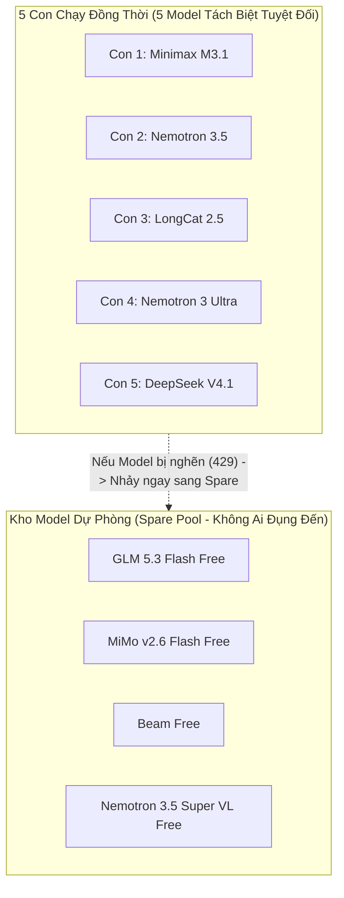

# Hướng Dẫn Vận Hành Hệ Thống 35 Con OpenCode (Model Free Pool & Triệt Tiêu Rate Limit)

> [!NOTE]
> Hệ thống hiện tại sở hữu **35 Instance OpenCode độc lập** (`con1` đến `con35`), vận hành trên 35 profile dữ liệu riêng biệt.
> Toàn bộ 35 con được tích hợp **kho 9 Model Free** của OpenCode cùng **cơ chế luân chuyển thông minh (Anti-RateLimit Matrix)** giúp 5 con bot chạy song song đồng thời mà **không bao giờ bị tắc nghẽn hay chạm trần Rate Limit**.

---

## 1. Bản Đồ 9 Model Free & Cơ Chế Phân Bổ 35 Con

OpenCode cung cấp sẵn 9 model miễn phí:
1. `opencode/minimax-m3.1-flash-free`
2. `opencode/nemotron-3.5-lightning-free`
3. `opencode/longcat-2.5-preview-free`
4. `opencode/nemotron-3-ultra-free`
5. `opencode/deepseek-v4.1-flash-free`
6. `opencode/glm-5.3-flash-free`
7. `opencode/mimo-v2.6-flash-free`
8. `opencode/beam-free`
9. `opencode/nemotron-3.5-super-vl-free`

### Bảng phân bổ 35 Con:

| Nhóm Con | Vai trò tiêu biểu | Model Free chính | Spare Fallback Pool |
| :--- | :--- | :--- | :--- |
| **`con1`** | Lead Architect & Planner | `minimax-m3.1-flash-free` | `glm-5.3`, `mimo`, `beam`, `super-vl`... |
| **`con2`** | Worker 1: Identity & Auth | `nemotron-3.5-lightning-free`| `mimo`, `beam`, `super-vl`, `glm-5.3`... |
| **`con3`** | Worker 2: Money & Network | `longcat-2.5-preview-free` | `beam`, `super-vl`, `glm-5.3`, `mimo`... |
| **`con4`** | Worker 3: QA & Tests | `nemotron-3-ultra-free` | `super-vl`, `glm-5.3`, `mimo`, `beam`... |
| **`con5`** | Reviewer & Docs | `deepseek-v4.1-flash-free` | `glm-5.3`, `mimo`, `beam`, `super-vl`... |
| **`con6` -> `con9`** | UI, Logic, DB, Security | `glm-5.3`, `mimo`, `beam`, `super-vl` | Xoay vòng qua 8 model còn lại |
| **`con10` -> `con15`**| Explorer, Optimizer, Auditor, Release... | Trải đều theo modulo 9 | Xoay vòng qua 8 model còn lại |
| **`con16` -> `con35`**| Các chuyên gia chuyên biệt (Frontend, Integrator, API, E2E...) | Trải đều theo modulo 9 | Xoay vòng qua 8 model còn lại |

---

## 2. Vì Sao 5 Con Chạy Song Song Sẽ "KHÔNG BAO GIỜ BỊ RATE LIMIT"?

Khi chạy song song 5 con (như trong dây chuyền `opencode-pipeline`):



1. **Tách biệt 100% Model khi chạy:** 5 con cùng chạy sẽ gọi vào **5 model hoàn toàn khác nhau** trên máy chủ. Chúng không bao giờ tranh chấp quota của nhau.
2. **Kho dự phòng 4 Model không ai đụng đến:** Luôn có sẵn 4 model dự phòng (`glm-5.3`, `mimo-v2.6`, `beam`, `nemotron-super-vl`). Nếu bất kỳ con nào gặp rate limit, nó sẽ nhảy ngay vào kho dự phòng này.
3. **Vòng lặp kiên trì 3 vòng (Auto Retry & Backoff):** Nếu toàn bộ cụm model đều tạm thời chạm trần do mạng, bot sẽ tự động sleep 5s -> 10s để quota hồi phục rồi thử lại, tuyệt đối không crash hay thoát ngang.

---

## 3. Cách Sử Dụng 35 Con

### Mở trực tiếp từng con để tương tác:
```bash
con1    # đến con35
# hoặc dùng alias:
opencode1   # đến opencode35
```

### Đăng nhập tài khoản độc lập (nếu có tài khoản riêng):
```bash
con1 auth login
con2 auth login
# ...
con35 auth login
```

### Chạy dây chuyền song song tối ưu:
```bash
opencode-pipeline "Nội dung nhiệm vụ của bạn"
```

### Giám sát thời gian thực:
```bash
opencode-monitor
```
