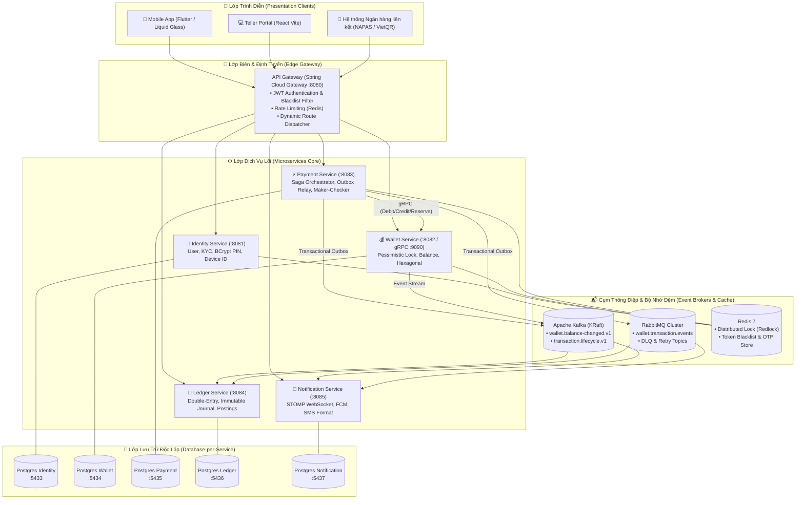

# 🚀 Sen Hồng Core Banking & E-Wallet Microservices System

[](https://www.oracle.com/java/)
[](https://spring.io/projects/spring-boot)
[](https://flutter.dev/)
[](https://www.docker.com/)
[](https://www.postgresql.org/)
[](https://kafka.apache.org/)
[](https://www.rabbitmq.com/)
[](https://redis.io/)
[](#-kiến-trúc-hệ-thống)

---

## 📌 1. Giới Thiệu Tổng Quan

Hệ thống **Sen Hồng Core Banking & E-Wallet** là nền tảng tài chính số toàn diện, kết hợp giữa:
1. **Backend Microservices Core** (Java 17 / Spring Boot 3) đạt chuẩn kiến trúc ngân hàng lõi **Database-per-Service**, giao tiếp đa kênh **gRPC** hiệu năng cao, điều phối giao dịch phân tán **Saga Orchestration**, xuất bản sự kiện theo mô hình **Transactional Outbox**, và hạch toán **Sổ cái kép bất biến (Double-Entry Ledger)**.
2. **Mobile Client - Sen Hồng Bank** (Flutter 3 / Dart) xây dựng theo chuẩn **Clean Architecture**, trang bị giao diện **Liquid Glass (iOS Glassmorphism)** cao cấp, hỗ trợ xác thực sinh trắc học (Biometrics), quét mã VietQR chuẩn EMVCo, và nhận thông báo biến động số dư Realtime qua WebSocket/FCM.
3. **Teller Cash Deposit Web Portal** (React 18 / Vite / TailwindCSS) dành cho cán bộ quầy chi nhánh thực hiện quy trình phê duyệt nạp tiền mặt 2 cấp **Maker-Checker** kèm kiểm soát hạn mức két quỹ (Vault Limits).



---

## 🏛️ 2. Kiến Trúc Kỹ Thuật (Architecture Highlights)

### 2.1. Phân Vùng Độc Lập Database-per-Service
Hệ thống loại bỏ hoàn toàn việc chia sẻ cơ sở dữ liệu giữa các dịch vụ:
- Mỗi microservice sở hữu một **PostgreSQL instance** riêng biệt, tài khoản DB riêng biệt và migration script Flyway riêng biệt.
- Dịch vụ này không bao giờ được phép truy vấn trực tiếp bảng của dịch vụ khác. Mọi trao đổi dữ liệu bắt buộc thông qua **REST API**, **gRPC** (cho giao dịch đồng bộ tốc độ cao) hoặc **Kafka / RabbitMQ** (cho bất đồng bộ hướng sự kiện).

### 2.2. Giao Dịch Phân Tán Saga Orchestration & Transactional Outbox
1. **Saga Orchestrator (`PaymentSagaOrchestrator`)**: Điều phối quy trình chuyển tiền P2P qua 4 bước nghiêm ngặt:
   - **Step 1:** Kiểm tra hạn mức & đóng băng số dư nguồn (`RESERVE_BALANCE` qua gRPC).
   - **Step 2:** Khấu trừ số dư nguồn (`DEBIT_WALLET`).
   - **Step 3:** Cộng số dư đích (`CREDIT_WALLET`).
   - **Compensating Action (Bù trừ):** Nếu bước 3 thất bại, kích hoạt bù trừ giải phóng số dư đóng băng hoặc hoàn lại tiền cho ví nguồn ngay lập tức.
2. **Transactional Outbox Pattern**: Lưu trữ sự kiện trong cùng giao dịch cơ sở dữ liệu với bản ghi thanh toán vào bảng `outbox_events`. Worker `OutboxRelay` định kỳ quét và phân phối đồng thời tới **RabbitMQ** (đẩy task sang Ledger/Notification) và **Kafka** (ghi nhận event stream phân tích) với cơ chế bảo đảm *At-least-once Delivery*.

### 2.3. Sổ Cái Kế Toán Kép (Double-Entry Bookkeeping)
- Mỗi giao dịch thanh toán tạo ra một `JournalEntry` bất biến (`status = POSTED`).
- Đi kèm ít nhất 2 dòng `LedgerPosting`: một bên **NỢ (DEBIT)** và một bên **CÓ (CREDIT)**.
- Quy tắc bất biến: $\sum \text{Debit} = \sum \text{Credit}$ (độ lệch $\Delta = 0.00\text{ VND}$). Bất kỳ giao dịch nào làm mất cân bằng sổ cái sẽ lập tức bị ném ngoại lệ `LedgerUnbalancedException` và chặn lại ở tầng nghiệp vụ.

### 2.4. Khóa Hàng Bi Quan (Pessimistic Locking) & Chống Race Condition
- Thao tác thay đổi số dư ví tại `wallet-service` sử dụng câu truy vấn `SELECT ... FOR UPDATE` kết hợp khóa phân tán Redis (`DistributedLockPort`).
- Kiểm tra tính lũy trị (`Idempotency-Key`) ở tầng Gateway và Redis giúp ngăn chặn rủi ro nhấn lặp thanh toán hoặc retry mạng.

---

## ⚙️ 3. Chi Tiết Các Microservices Backend

| Microservice | Cổng HTTP | Cổng gRPC | Cơ sở dữ liệu | Trách nhiệm chính |
| :--- | :---: | :---: | :---: | :--- |
| **`api-gateway`** | `8080` | — | Redis (:6379) | Cửa ngõ duy nhất, xác thực JWT, tra cứu Redis Token Blacklist, Rate Limiting, CORS, Proxy WebSocket. |
| **`identity-service`** | `8081` | — | `ewallet_identity_db` (:5433) | Đăng ký, đăng nhập, cấp JWT (Access + Refresh Token), băm mã PIN BCrypt, xác thực OTP qua Redis, quản lý Device ID và trạng thái KYC. |
| **`wallet-service`** | `8082` | `9090` | `ewallet_wallet_db` (:5434) | Quản lý vòng đời ví, số dư khả dụng/đóng băng, hạn mức ngày/tháng, xử lý Debit/Credit qua gRPC tốc độ cao, bắn sự kiện Kafka `banking.wallet.balance-changed.v1`. |
| **`payment-service`** | `8083` | — | `ewallet_payment_db` (:5435) | Máy trạng thái thanh toán, điều phối Saga P2P, Outbox Relay, nghiệp vụ nạp tiền mặt tại quầy Maker-Checker, quản lý hạn mức két quỹ chi nhánh. |
| **`ledger-service`** | `8084` | — | `ewallet_ledger_db` (:5436) | Sổ cái kế toán kép bất biến, tài khoản hệ thống (System Cash Vault, User Settlement), chống duplicate posting giữa RabbitMQ và Kafka. |
| **`notification-service`** | `8085` | — | `ewallet_notification_db` (:5437) | Đẩy thông báo WebSocket STOMP (`/topic/notifications`), Firebase Cloud Messaging (FCM), chuẩn hóa nội dung tin nhắn biến động số dư SMS Banking. |
| **`common-library`** | — | — | — | Protobuf definitions (`wallet.proto`), gRPC stubs, shared DTOs, Event Envelopes, Jackson Serializers. |

---

## 📱 4. Ứng Dụng Mobile - Sen Hồng Bank (Flutter)

Ứng dụng di động được cấu trúc theo mô hình **Clean Architecture** kết hợp thư viện giao diện độc quyền **Liquid Glass**:

```
mobile/
├── lib/
│   ├── core/                        # Nền tảng dùng chung
│   │   ├── constants/               # ApiConstants (IP Gateway, WS Endpoints)
│   │   ├── network/                 # DioClient, AuthInterceptor, ErrorParser
│   │   ├── security/                # BiometricAuthService, SecureStorage
│   │   ├── theme/                   # Sen Hồng Palette, Liquid Glass Theme
│   │   └── utils/                   # CurrencyFormatter, DateUtils, VietQR Helper
│   ├── data/                        # Lớp Dữ liệu (Data Layer)
│   │   ├── datasources/remote/      # REST API & WebSocket Remote Data Sources
│   │   ├── models/                  # DTO Models (JSON to Entity)
│   │   └── repositories/            # Triển khai Repository Contracts
│   ├── domain/                      # Lớp Nghiệp vụ Lõi (Domain Layer)
│   │   ├── entities/                # User, Wallet, Transaction, Notification
│   │   ├── repositories/            # Repository Interfaces
│   │   └── usecases/                # LoginUseCase, TransferUseCase, TopupUseCase
│   └── presentation/                # Lớp Giao diện (Presentation Layer)
│       ├── bloc/cubit/              # Quản lý State (AuthBloc, WalletCubit, TransferBloc)
│       ├── screens/                 # 50+ Màn hình chức năng
│       └── widgets/                 # Floating Notification HUD, GlassCard, CustomKeypad
├── test/
│   └── qa_commits_review_test.dart  # Bộ test tự động kiểm định kết nối & logic Mobile
└── run.sh                           # CLI điều khiển vòng đời ứng dụng Mobile
```

### Các Tính Năng Nổi Bật Trên Mobile:
1. **Thiết kế Liquid Glass:** Hiệu ứng kính mờ thời thượng (Backdrop Blur, Gradient Border, Specular Lighting), tương thích hoàn hảo Dark/Light mode.
2. **Chuyển tiền P2P Saga:** Tra cứu tự động tên chủ tài khoản thụ hưởng qua số điện thoại; bảo mật xác nhận bằng mã PIN 6 số hoặc sinh trắc học FaceID / Vân tay.
3. **Thanh toán VietQR & Quét mã:** Tự động sinh mã VietQR động theo chuẩn EMVCo kèm thông tin số tiền và nội dung; tích hợp bộ quét `mobile_scanner` nhận diện tức thì.
4. **Biến động số dư Realtime:** Lắng nghe trực tiếp từ WebSocket và hiển thị thanh **Floating Notification HUD** động với cú pháp chuẩn ngân hàng:
   > `TK 0981xxxx GD thành công. PS: -250.000 VND. SD: 750.000 VND - ND: Chuyển tiền`
5. **Sao kê & Lịch sử giao dịch:** Phân trang vô hạn, theo dõi số dư chạy (`runningBalance`), tìm kiếm theo ngày và xuất biên lai PDF chuẩn xác.

---

## 💻 5. Cổng Giao Dịch Viên Quầy (React Vite Portal)

Dành cho cán bộ giao dịch (Teller) và kiểm soát viên (Manager) tại các chi nhánh:
- **Nghiệp vụ Nạp Tiền Mặt (Cash Deposit):**
  - **Giao dịch viên (Teller):** Nhập số điện thoại khách hàng, kiểm tra thông tin ví và tạo lệnh nạp tiền.
  - **Kiểm soát viên (Manager):** Duyệt hoặc từ chối các giao dịch vượt hạn mức phê duyệt tự động (`auto-approve limit`).
- **Kiểm soát Két Quỹ (Branch Vault):** Giám sát hạn mức tồn quỹ tiền mặt chi nhánh (mặc định 500,000,000 VND), ngăn chặn thất thoát và vi phạm quy định an toàn tiền tệ.

---

## 🚀 6. Hướng Dẫn Cài Đặt & Khởi Chạy

### 6.1. Yêu Cầu Môi Trường
- **Hệ điều hành:** Linux (Ubuntu 22.04+ khuyên dùng), macOS hoặc Windows (WSL2).
- **Công cụ cơ sở:**
  - Docker Engine 24+ & Docker Compose v2
  - Java JDK 17 (OpenJDK hoặc Corretto) & Apache Maven 3.9+
  - Flutter SDK 3.19+ & Android SDK / Android Studio
  - Node.js 18+ & npm (nếu chạy Web Portal)

---

### 6.2. Khởi Động Nhanh Toàn Bộ Hệ Thống (Khuyên Dùng)

#### Cách A: Sử dụng Bộ điều khiển vận hành tổng thể `run.sh`
```bash
# Cấp quyền thực thi
chmod +x run.sh ./mobile/run.sh

# 1. Khởi động toàn bộ Infra + Microservices + React Portal
./run.sh all

# 2. Hoặc khởi động riêng từng thành phần:
./run.sh infra      # 5 Postgres DBs, Redis, RabbitMQ, Kafka, Kafka-UI
./run.sh be         # 6 Spring Boot Microservices
./run.sh fe         # Cổng giao dịch viên React (:5173)
./run.sh health     # Kiểm tra trạng thái sức khỏe toàn bộ cổng dịch vụ
```

#### Cách B: Khởi động thuần với Docker Compose
```bash
# Xây dựng và khởi chạy tất cả 14 containers (5 DBs + 3 Brokers + 6 Services)
docker compose up -d --build

# Xem log các dịch vụ
docker compose logs -f api-gateway wallet-service payment-service
```

---

### 6.3. Khởi Chạy Ứng Dụng Mobile Flutter
Sử dụng script `./mobile/run.sh` để tự động hóa toàn bộ việc kết nối ADB Reverse và mở app:

```bash
cd mobile

# 1. Cài đặt các gói thư viện
./run.sh deps

# 2. Phân tích mã nguồn và kiểm tra lỗi cú pháp
./run.sh analyze

# 3. Chạy ứng dụng trên Thiết bị thật / Emulator (Tự động chạy adb reverse tcp:8080 tcp:8080)
./run.sh run

# 4. Chạy bộ kiểm thử tự động Mobile QA
./run.sh test
```

> [!TIP]
> Khi chạy trên thiết bị Android thật qua cáp USB, lệnh `adb reverse tcp:8080 tcp:8080` được cấu hình tự động trong `mobile/run.sh` để thiết bị di động truy cập trực tiếp API Gateway tại `localhost:8080` mà không cần đổi địa chỉ IP mạng LAN.

---

## 🧪 7. Kiểm Thử Tự Động & Đối Soát E2E

### 7.1. Chạy Unit & Integration Tests Backend
```bash
# Kiểm thử toàn diện wallet-service (Bao gồm Concurrency & Kafka tests)
mvn -f backend/services/wallet-service/pom.xml test

# Kiểm thử payment-service (Saga Orchestration & Outbox Relay)
mvn -f backend/services/payment-service/pom.xml test

# Kiểm thử toàn bộ các microservices
mvn clean test
```

### 7.2. Kiểm Thử Mobile QA Test Suite
```bash
cd mobile
flutter test test/qa_commits_review_test.dart
```

### 7.3. Kịch Bản Kiểm Thử E2E Toàn Trình (9 Bước Dữ Liệu Thật)
Hệ thống cung cấp kịch bản kiểm thử tự động không can thiệp code (Black-box E2E probe):
```bash
bash scratch/test_e2e_baseline.sh
```

**Các bước kịch bản kiểm định:**
1. Đăng ký tài khoản người gửi (Alice) & người nhận (Bob) qua API Gateway.
2. Tra cứu mã định danh ví tương ứng từ `wallet-service`.
3. Nạp tiền `1,000,000 VND` vào ví của Alice.
4. Thực hiện lệnh chuyển tiền P2P `250,000 VND` từ Alice sang Bob (Saga điều phối gRPC Debit & Credit).
5. Xác minh hàng đợi RabbitMQ đã tiêu thụ hết thông điệp (`messages = 0`).
6. Truy vấn `ewallet_ledger_db`: Kiểm tra bút toán kép cân bằng (`DEBIT 250,000` & `CREDIT 250,000`).
7. Truy vấn `ewallet_notification_db`: Kiểm tra tạo tin nhắn biến động số dư và SMS Banking cho cả 2 bên.
8. Truy vấn API Gateway `/transactions`: Xác nhận `runningBalance` của Alice giảm chính xác còn `750,000 VND`.

---

## 📡 8. Danh Mục Cổng Dịch Vụ & API Endpoints

| Dịch vụ | Giao thức / Cổng | URL Truy cập / Endpoint | Chức năng |
| :--- | :---: | :--- | :--- |
| **API Gateway** | `HTTP :8080` | `http://localhost:8080` | Endpoint tiếp nhận duy nhất cho Client |
| **Swagger UI** | `HTTP :8080` | `http://localhost:8080/swagger-ui.html` | Tài liệu API tương tác trực tiếp |
| **Identity Service** | `HTTP :8081` | `http://localhost:8080/api/v1/auth` | Đăng ký, Đăng nhập, Đổi PIN, OTP |
| **Wallet Service** | `HTTP :8082` | `http://localhost:8080/api/v1/wallets` | Thông tin ví, nạp tiền, hạn mức |
| **Wallet gRPC** | `gRPC :9090` | `wallet-service:9090` | RPC nội bộ cho Payment Service |
| **Payment Service** | `HTTP :8083` | `http://localhost:8080/api/v1/payments` | Chuyển tiền P2P, Maker-Checker nạp tiền |
| **Ledger Service** | `HTTP :8084` | `http://localhost:8080/api/v1/ledger` | Truy vấn bút toán, sổ cái kép |
| **Notification Service** | `HTTP :8085` | `ws://localhost:8080/ws-native` | WebSocket STOMP nhận thông báo số dư |
| **RabbitMQ Dashboard** | `HTTP :15672` | `http://localhost:15672` | Quản trị Broker (User: `wallet` / Pass: `wallet123`) |
| **Kafka UI (Monitoring)**| `HTTP :8090` | `http://localhost:8090` | Giám sát Kafka Topics & Consumer Groups |
| **Teller React Portal** | `HTTP :5173` | `http://localhost:5173` | Cổng giao diện cán bộ quầy chi nhánh |

---

## 🔒 9. Tiêu Chuẩn Bảo Mật Ngân Hàng

> [!IMPORTANT]
> - **Mật khẩu & Mã PIN:** Được mã hóa một chiều bằng thuật toán `BCrypt` với độ phức tạp cao (`strength = 12`). Mã PIN thanh toán được lưu trữ tách biệt hoàn toàn với mật khẩu đăng nhập.
> - **JWT Blacklist & Thu Hồi:** Đưa token vào Redis Blacklist ngay khi người dùng chọn Đăng xuất, vô hiệu hóa ngay lập tức các token còn hạn.
> - **Khóa tài khoản tự động:** Tự động khóa đăng nhập 30 phút khi phát hiện 5 lần nhập sai liên tiếp; khóa chức năng thanh toán khi nhập sai mã PIN 3 lần.
> - **Tính lũy trị (Idempotency):** Tất cả các API thay đổi trạng thái tiền tệ bắt buộc cung cấp Header `Idempotency-Key` (UUIDv4) để chống double-spending khi mạng chập chờn.
> - **Tuân thủ Chuẩn UTC:** Toàn bộ dấu thời gian (`createdAt`, `updatedAt`, `postedAt`) được lưu trữ dưới định dạng chuẩn ISO-8601 UTC trong Database và trao đổi qua JSON.

---

## 👥 10. Đóng Góp & Giấy Phép

- Dự án được phát triển nhằm phục vụ mục đích nghiên cứu, học thuật và trình diễn kiến trúc công nghệ tài chính lõi ngân hàng số đạt chuẩn quốc tế.
- **Giấy phép:** [MIT License](LICENSE). Mọi hành vi sao chép phục vụ thương mại cần tuân thủ quy định cấp phép của tác giả.

> [!IMPORTANT]
> - **Mật khẩu & Mã PIN:** Được mã hóa một chiều bằng thuật toán `BCrypt` với độ phức tạp cao (`strength = 12`). Mã PIN thanh toán được lưu trữ tách biệt hoàn toàn với mật khẩu đăng nhập.
> - **JWT Blacklist & Thu Hồi:** Đưa token vào Redis Blacklist ngay khi người dùng chọn Đăng xuất, vô hiệu hóa ngay lập tức các token còn hạn.
> - **Khóa tài khoản tự động:** Tự động khóa đăng nhập 30 phút khi phát hiện 5 lần nhập sai liên tiếp; khóa chức năng thanh toán khi nhập sai mã PIN 3 lần.
> - **Tính lũy trị (Idempotency):** Tất cả các API thay đổi trạng thái tiền tệ bắt buộc cung cấp Header `Idempotency-Key` (UUIDv4) để chống double-spending khi mạng chập chờn.
> - **Tuân thủ Chuẩn UTC:** Toàn bộ dấu thời gian (`createdAt`, `updatedAt`, `postedAt`) được lưu trữ dưới định dạng chuẩn ISO-8601 UTC trong Database và trao đổi qua JSON.

---

## 👥 10. Đóng Góp & Giấy Phép

- Dự án được phát triển nhằm phục vụ mục đích nghiên cứu, học thuật và trình diễn kiến trúc công nghệ tài chính lõi ngân hàng số đạt chuẩn quốc tế.
- **Giấy phép:** [MIT License](LICENSE). Mọi hành vi sao chép phục vụ thương mại cần tuân thủ quy định cấp phép của tác giả.

