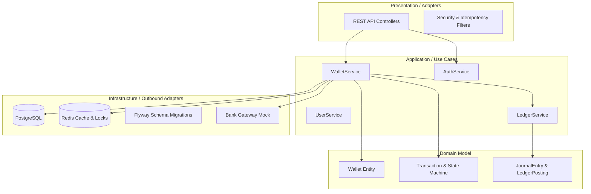

# 🚀 Fintech E-Wallet: Hệ Thống Ví Điện Tử Đạt Chuẩn Ngân Hàng

[](https://www.oracle.com/java/)
[](https://spring.io/projects/spring-boot)
[](#-kiểm-thử-tự-động)
[](LICENSE)

---

## 📌 1. Giới Thiệu Tổng Quan

Dự án là một hệ thống **Ví điện tử (E-Wallet)** hoàn chỉnh, kết hợp giữa **Backend Core** đạt tiêu chuẩn ngân hàng (Java 17 / Spring Boot 3) và **Mobile Client** (React Native Expo / TypeScript) với giao diện chuẩn iOS Glassmorphism cao cấp.

Hệ thống được thiết kế theo kiến trúc **Hexagonal Architecture (Ports and Adapters)** kết hợp với **Domain-Driven Design (DDD)** nhằm đảm bảo tính toàn vẹn tài chính, khả năng mở rộng và độc lập hoàn toàn giữa logic nghiệp vụ và hạ tầng công nghệ.



---

## 🏆 2. 18 Tính Năng Kỹ Thuật Lõi (Core Features)

| Nhóm | # | Tính Năng | Mô Tả Kỹ Thuật |
| :--- | :---: | :--- | :--- |
| **Toàn vẹn số dư** | 1 | **Idempotency & Row-Level Lock** | Chống lặp giao dịch bằng Header `Idempotency-Key` + Khóa hàng `SELECT ... FOR UPDATE` + Distributed Lock Redis. |
| | 2 | **Sổ cái kép (Double-Entry Ledger)** | Mỗi giao dịch tạo 1 `JournalEntry` và 2+ `LedgerPosting` (1 Nợ - 1 Có) cân bằng tuyệt đối. |
| | 3 | **Soft Delete & Immutability** | Bảo toàn tính bất biến cho sổ cái, nhật ký kiểm toán và giao dịch tài chính. |
| **Bảo mật & Xác thực** | 4 | **Xác thực 2 lớp PIN/OTP** | Mã PIN băm BCrypt + OTP 6 số ngẫu nhiên qua Redis với cơ chế tự động khóa sau 3 lần sai. |
| | 5 | **Khóa đăng nhập tạm thời** | Tự động khóa tài khoản 30 phút sau 5 lần sai mật khẩu liên tiếp. |
| | 6 | **Thu hồi Token khi Đăng xuất** | Đưa Refresh/Access Token vào Redis Blacklist khi logout, chặn truy cập tức thì. |
| | 7 | **Rate Limiting công khai** | Áp dụng `RedisRateLimiter` trên `/login`, `/register`, `/forgot-password`, `/otp/send`. |
| | 8 | **Audit Log tập trung** | Ghi nhận IP và User-Agent động qua `ClientInfoPort`. |
| **Nghiệp vụ thanh toán** | 9 | **Chuẩn hóa VietQR / EMVCo** | Sinh và giải mã mã QR chuẩn EMVCo TLV kèm mã kiểm tra lỗi CRC-16. |
| | 10 | **Xác minh người nhận trước khi chuyển** | API tra cứu tên người nhận che bớt (`NGUYEN V** AN`) chống chuyển nhầm tiền. |
| | 11 | **Hạn mức giao dịch ngày & tháng** | Kiểm tra sớm (Pre-lock) hạn mức ngày (100M) và tháng (500M) theo từng cấp độ KYC. |
| | 12 | **Giới hạn số tiền trên từng giao dịch** | Tối thiểu 1,000 VND, tối đa 50,000,000 VND trên 1 giao dịch đơn lẻ. |
| **Vận hành & Hệ thống** | 13 | **Transaction State Machine & Saga** | Máy trạng thái 6 bước + Tự động hoàn tiền bù trừ (Reversal) khi lỗi kết nối ngân hàng. |
| | 14 | **Global Exception Handler** | Chuẩn hóa định dạng lỗi JSON với mã `errorCode` tường minh. |
| | 15 | **Spring Boot Actuator** | Mở các endpoint giám sát `/actuator/health`, `/actuator/info`, `/actuator/metrics`. |
| | 16 | **Chuẩn hóa UTC toàn hệ thống** | Lưu trữ toàn bộ timestamp theo chuẩn UTC (`Instant`) trên Hibernate và Jackson. |
| | 17 | **Pagination chuẩn** | Generic model `PageResponse<T>` đầy đủ metadata (`totalPages`, `totalElements`, `last`). |
| | 18 | **Flyway & Swagger/OpenAPI** | Migration schema tự động (`V1__init_schema.sql`) và Swagger UI tương tác trực tiếp. |

---

## 🛠️ 3. Hướng Dẫn Cài Đặt & Khởi Chạy

### Cách 1: Chạy bằng Docker Compose (Khuyên dùng)
```bash
# Khởi động toàn bộ Postgres, Redis và Spring Boot Backend
docker compose up -d --build
```
- **Backend API:** `http://localhost:8080`
- **Swagger UI:** `http://localhost:8080/swagger-ui/index.html`
- **Actuator Health:** `http://localhost:8080/actuator/health`

---

### Cách 2: Chạy cục bộ (Local Development)

#### 1. Backend (Spring Boot 3)
```bash
# Chạy toàn bộ test suite (263 tests)
mvn clean test

# Khởi chạy ứng dụng
mvn spring-boot:run
```

#### 2. Mobile App (React Native Expo)
```bash
cd mobile-app

# Cài đặt dependencies
npm install

# Kiểm tra TypeScript typecheck
npx tsc --noEmit

# Khởi chạy Metro Bundler
npm start
```

---

## 🧪 4. Kiểm Thử Tự Động (Automated Testing)

Toàn bộ 263 kịch bản kiểm thử được tự động hóa hoàn toàn với **JUnit 5**, **Mockito**, và **Spring Boot Test**:
```text
[INFO] Results:
[INFO] Tests run: 263, Failures: 0, Errors: 0, Skipped: 0
[INFO] BUILD SUCCESS
```

---

## 📚 5. Tài Liệu Dự Án Chi Tiết
- [THESIS_DEFENSE_GUIDE.md](file:///home/wsk2/app-mono-di-va-khoa/THESIS_DEFENSE_GUIDE.md): Sổ tay hướng dẫn bảo vệ đồ án & bộ câu hỏi chất vấn.
- [fintech-wallet.postman_collection.json](file:///home/wsk2/app-mono-di-va-khoa/fintech-wallet.postman_collection.json): Bộ sưu tập Postman API.
- [scripts/demo_full_flow.sh](file:///home/wsk2/app-mono-di-va-khoa/scripts/demo_full_flow.sh): Script demo toàn bộ luồng nghiệp vụ.
