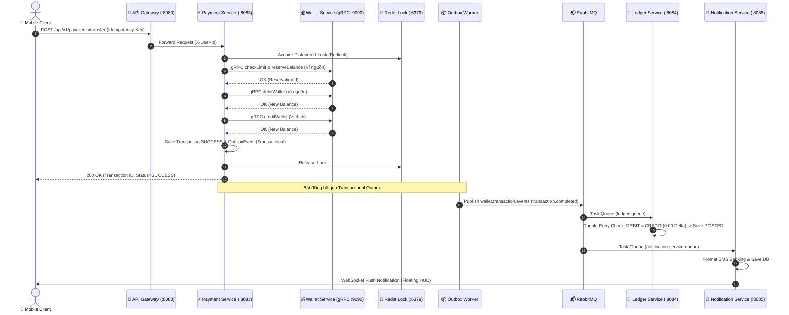

# ⚙️ Sen Hồng Core Banking Backend Microservices

[](https://www.oracle.com/java/)
[](https://spring.io/projects/spring-boot)
[](https://grpc.io/)
[](https://www.postgresql.org/)
[](https://kafka.apache.org/)
[](https://www.rabbitmq.com/)
[](https://redis.io/)

Hệ thống Backend ngân hàng lõi và ví điện tử số xây dựng theo tiêu chuẩn kiến trúc **Database-per-Service**, điều phối giao dịch phân tán **Saga Orchestrator**, xuất bản sự kiện bất đồng bộ **Transactional Outbox**, và kiểm soát tính toàn vẹn số dư qua **Sổ cái kép bất biến (Double-Entry Ledger)**.

---

## 🏛️ 1. Cấu Trúc Dự Án Backend

```text
backend/
├── pom.xml                               # Root Maven Parent POM
├── common-library/                       # Thư viện chia sẻ dùng chung
│   ├── src/main/proto/wallet.proto       # Định nghĩa gRPC Protobuf
│   └── src/main/java/com/fintech/common/ # DTOs, Envelopes, Events, Exceptions
└── services/
    ├── api-gateway/                      # Spring Cloud Gateway (Port 8080)
    │   └── src/main/java/.../filter/     # JwtAuthFilter, RateLimitFilter
    ├── identity-service/                 # Quản lý tài khoản & Xác thực (Port 8081)
    │   └── src/main/resources/db/migration/V1__init_identity_db.sql
    ├── wallet-service/                   # Quản lý ví & Số dư lõi (Port 8082 / gRPC 9090)
    │   ├── src/main/java/.../domain/     # Hexagonal Domain Models & Ports
    │   ├── src/main/java/.../grpc/       # WalletGrpcServiceImpl
    │   └── src/main/resources/db/migration/V1__init_wallet_db.sql
    ├── payment-service/                  # Thanh toán & Saga Orchestration (Port 8083)
    │   ├── src/main/java/.../saga/       # PaymentSagaOrchestrator
    │   ├── src/main/java/.../outbox/     # OutboxRelay & OutboxEvent
    │   └── src/main/resources/db/migration/V1__init_payment_db.sql
    ├── ledger-service/                   # Sổ cái kế toán kép (Port 8084)
    │   ├── src/main/java/.../service/    # LedgerService (DEBIT/CREDIT balance check)
    │   └── src/main/resources/db/migration/V1__init_ledger_db.sql
    └── notification-service/             # Thông báo đa kênh & WebSocket (Port 8085)
        ├── src/main/java/.../websocket/  # Native WebSocket & STOMP Broker
        └── src/main/resources/db/migration/V1__init_notification_db.sql
```

---

## 🔄 2. Luồng Xử Lý Giao Dịch Phân Tán (P2P Saga Flow)



---

## 💾 3. Danh Mục Cơ Sở Dữ Liệu Độc Lập (Database-per-Service)

| Database | Service Sở Hữu | Port Host | User | Password | Bảng Nghiệp Vụ Chính |
| :--- | :--- | :---: | :--- | :--- | :--- |
| **`ewallet_identity_db`** | `identity-service` | `5433` | `identity_db_user` | `IdentityDb#Secure2025!` | `users`, `user_roles`, `user_devices`, `user_kyc` |
| **`ewallet_wallet_db`** | `wallet-service` | `5434` | `wallet_db_user` | `WalletDb#Secure2025!` | `wallets`, `wallet_audit_logs`, `balance_snapshots` |
| **`ewallet_payment_db`** | `payment-service` | `5435` | `payment_db_user` | `PaymentDb#Secure2025!` | `transactions`, `outbox_events`, `cash_deposits` |
| **`ewallet_ledger_db`** | `ledger-service` | `5436` | `ledger_app_user` | `LedgerApp#Secure2025!` | `journal_entries`, `ledger_postings`, `ledger_accounts` |
| **`ewallet_notification_db`** | `notification-service` | `5437` | `notification_db_user` | `NotificationDb#Secure2025!` | `notifications`, `user_tokens`, `device_registrations` |

---

## 🛠️ 4. Hướng Dẫn Biên Dịch & Chạy Kiểm Thử

### 4.1. Biên Dịch Toàn Bộ Mã Nguồn
```bash
# Biên dịch protobuf stubs và toàn bộ microservices
mvn clean compile -DskipTests
```

### 4.2. Chạy Bộ Kiểm Thử Từng Dịch Vụ
```bash
# 1. Wallet Service Unit & Concurrency Tests:
mvn -f services/wallet-service/pom.xml test

# 2. Payment Service Saga & Outbox Tests:
mvn -f services/payment-service/pom.xml test

# 3. Chạy toàn bộ test suites của 6 services:
mvn clean test
```

### 4.3. Chạy Dịch Vụ Cục Bộ (Local Spring Boot)
Khi cụm hạ tầng Docker đã chạy (`docker compose up -d postgres-identity ...`):
```bash
# Chạy API Gateway
mvn -f services/api-gateway/pom.xml spring-boot:run

# Chạy Wallet Service
mvn -f services/wallet-service/pom.xml spring-boot:run

# Chạy Payment Service
mvn -f services/payment-service/pom.xml spring-boot:run
```

---

## 🔒 5. Các Tiêu Chuẩn Kỹ Thuật Ngân Hàng Áp Dụng
1. **Hexagonal Architecture (Ports and Adapters):** Tách biệt ranh giới giữa Domain lõi và các Adapter hạ tầng (JPA, Redis, Kafka, gRPC).
2. **Double-Entry General Ledger:** Mỗi sự kiện thanh toán bắt buộc ghi nhận 2 chiều Nợ/Có cân bằng tuyệt đối, bảo toàn tính toàn vẹn tài chính.
3. **Pessimistic Row-Level Lock:** Áp dụng `SELECT FOR UPDATE` trên bảng `wallets` để đảm bảo an toàn tuyệt đối khi hàng trăm giao dịch nạp/rút diễn ra cùng lúc trên cùng một ví.
4. **Redlock Distributed Locking:** Khóa cấp độ cụm phân tán thông qua Redis, ngăn chặn hiện tượng double-spend giữa các instances của microservices.
5. **Idempotency Multi-Layer:** Lũy trị kép bằng cả Redis TTL và Unique Constraint trong cơ sở dữ liệu.

