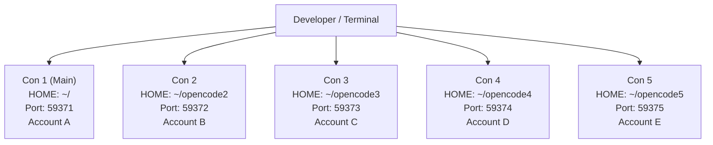

# Báo Cáo & Hướng Dẫn Cài Đặt Setup 5 Instance OpenCode Chạy Song Song

> [!NOTE]
> Tài liệu này tổng hợp toàn bộ kiến trúc và quy trình thiết lập thực tế hệ thống **5 "con" OpenCode** đang hoạt động trên máy, giúp bạn có thể gửi trực tiếp cho bạn bè làm theo từ A đến Z một cách dễ dàng và chuẩn xác nhất.

---

## 1. Bản Chất & Tại Sao Phải Setup 5 "Con" OpenCode?

OpenCode ([opencode.ai](https://opencode.ai)) là công cụ AI coding agent hoạt động dưới dạng terminal CLI kèm theo một **background service daemon** và cơ sở dữ liệu SQLite cục bộ (`opencode.db`).

* **Vấn đề khi dùng mặc định:** Nếu bạn mở 5 cửa sổ terminal và cùng gõ `opencode`, tất cả sẽ trỏ về cùng một thư mục cấu hình (`~/.config/opencode`), dùng chung 1 database (`~/.local/share/opencode`), dùng chung 1 port ngầm (`59371`) và chung 1 token/tài khoản. Điều này dẫn đến:
  * Tranh chấp lock SQLite (`database is locked`).
  * Trùng luồng xử lý hoặc bị đè session.
  * Nhanh chóng chạm ngưỡng Rate Limit / Quota của 1 tài khoản AI.
* **Giải pháp 5 Instance Độc Lập:**
  * Tạo 5 không gian `HOME` riêng biệt (`~/opencode1` đến `~/opencode5`).
  * Cấu hình 5 cổng mạng (Port) riêng biệt (`59371` đến `59375`).
  * Mỗi con có thể đăng nhập 1 tài khoản / API key độc lập, chạy 5 luồng code song song mà không bao giờ xung đột.



---

## 2. Bước 1: Cài Đặt OpenCode Gốc

Chỉ cần cài đặt OpenCode một lần duy nhất vào hệ thống:

```bash
# Tải và cài đặt OpenCode v2
curl -fsSL https://opencode.ai/v2/install | bash
```

Sau khi cài xong, nạp lại môi trường hoặc kiểm tra:
```bash
source ~/.bashrc
opencode --version
# Kết quả hiển thị dạng: opencode v2.x.x
```

---

## 3. Bước 2: Khởi Tạo Thư Mục & Đổi Port Cho 5 Con

Mỗi con OpenCode sẽ được gán 1 thư mục làm việc riêng và 1 port riêng:

| Tên Instance | Thư mục Home riêng | Cổng dịch vụ (Service Port) | Mục đích |
| :--- | :--- | :--- | :--- |
| **Con 1** | Mặc định (`/home/username`) | `59371` (mặc định) | Tài khoản chính / Dự án 1 |
| **Con 2** | `~/opencode2` | `59372` | Tài khoản 2 / Dự án 2 |
| **Con 3** | `~/opencode3` | `59373` | Tài khoản 3 / Dự án 3 |
| **Con 4** | `~/opencode4` | `59374` | Tài khoản 4 / Dự án 4 |
| **Con 5** | `~/opencode5` | `59375` | Tài khoản 5 / Dự án 5 |

Chạy các lệnh sau trên terminal để tạo và thiết lập cổng:

```bash
# 1. Tạo các thư mục lưu cấu hình riêng
mkdir -p ~/opencode2 ~/opencode3 ~/opencode4 ~/opencode5

# 2. Thiết lập Port cố định cho từng con
HOME=$HOME/opencode2 opencode service set port 59372
HOME=$HOME/opencode3 opencode service set port 59373
HOME=$HOME/opencode4 opencode service set port 59374
HOME=$HOME/opencode5 opencode service set port 59375
```

---

## 4. Bước 3: Tạo Phím Tắt Tiện Dụng (Tự Động Hóa)

Để không phải gõ dài dòng `HOME=...` mỗi lần mở, hãy thêm các alias hoặc tạo script tiện ích. 

Mở file `~/.bashrc` (hoặc `~/.zshrc` nếu dùng Mac/Zsh):
```bash
nano ~/.bashrc
```

Thêm vào cuối file đoạn cấu hình sau:

```bash
# ==========================================
# OpenCode Multi-Instance Aliases (5 Con)
# ==========================================
alias opencode1="opencode"
alias opencode2="HOME=\$HOME/opencode2 opencode"
alias opencode3="HOME=\$HOME/opencode3 opencode"
alias opencode4="HOME=\$HOME/opencode4 opencode"
alias opencode5="HOME=\$HOME/opencode5 opencode"

# Lệnh tắt toàn bộ 5 con khi cần reset
alias opencode-killall="pkill -f opencode"
```

Lưu lại (`Ctrl + O`, `Enter`, `Ctrl + X`) rồi kích hoạt:
```bash
source ~/.bashrc
```

Từ giờ, ở bất kỳ terminal nào:
* Muốn dùng con 1: gõ `opencode1`
* Muốn dùng con 2: gõ `opencode2`
* Muốn dùng con 3: gõ `opencode3`
* Muốn dùng con 4: gõ `opencode4`
* Muốn dùng con 5: gõ `opencode5`

---

## 5. Bước 4: Đăng Nhập Tài Khoản Riêng Biệt Cho Từng Con

Để 5 con chạy 5 tài khoản khác nhau (Anthropic, OpenAI, GitHub Copilot, Google Gemini,...):

1. **Đăng nhập con 1:**
   ```bash
   opencode1 auth login
   ```
2. **Đăng nhập con 2:**
   ```bash
   opencode2 auth login
   ```
3. **Đăng nhập con 3:**
   ```bash
   opencode3 auth login
   ```
4. **Đăng nhập con 4:**
   ```bash
   opencode4 auth login
   ```
5. **Đăng nhập con 5:**
   ```bash
   opencode5 auth login
   ```

*(Làm theo hướng dẫn trên trình duyệt hoặc paste API key tương ứng của từng tài khoản).*

---

## 6. Bước 5 (Tùy chọn): Sao Chép Cấu Hình MCP & Plugins

Nếu bạn có dùng các công cụ mở rộng như **Codebase Memory MCP** (`codebase-memory-mcp`) hoặc plugin tùy chỉnh ở con 1 và muốn các con khác cũng có sẵn:

```bash
# Tạo thư mục config cho các con
for i in 2 3 4 5; do
  mkdir -p ~/opencode$i/.config/opencode
  # Copy file cấu hình mcp nếu có
  if [ -f ~/.config/opencode/opencode.json ]; then
    cp ~/.config/opencode/opencode.json ~/opencode$i/.config/opencode/
  fi
  # Copy thư mục plugin nếu có
  if [ -d ~/.config/opencode/plugins ]; then
    cp -r ~/.config/opencode/plugins ~/opencode$i/.config/opencode/
  fi
done
```

---

## 7. Các Lệnh Quản Trị & Xử Lý Sự Cố Thường Gặp

> [!TIP]
> **Kiểm tra xem các con nào đang chạy:**
> ```bash
> ps aux | grep opencode | grep -v grep
> ```
> Hoặc kiểm tra xem các cổng 59371-59375 có đang hoạt động không:
> ```bash
> ss -tulpn | grep 5937
> ```

> [!CAUTION]
> **Khi bị kẹt tiến trình hoặc muốn khởi động lại toàn bộ:**
> Chạy lệnh dọn sạch tiến trình ngầm của OpenCode:
> ```bash
> pkill -f opencode
> ```
> Sau đó mở lại từng con bình thường.
